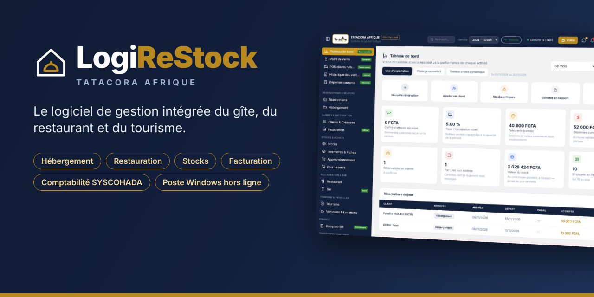
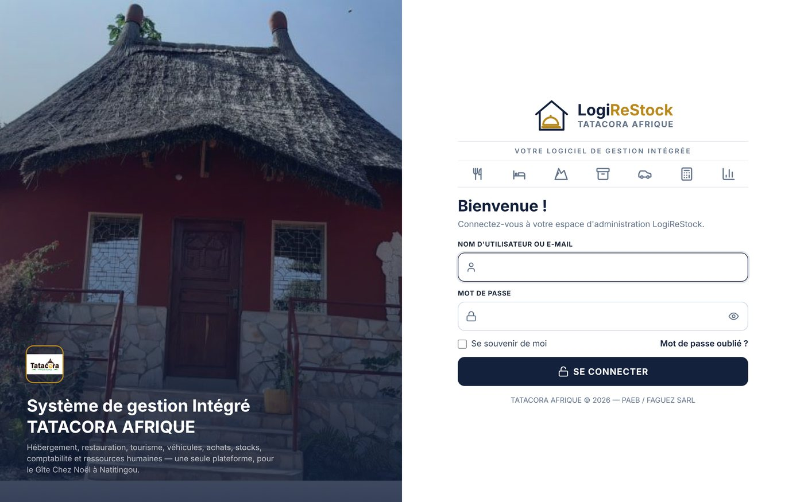
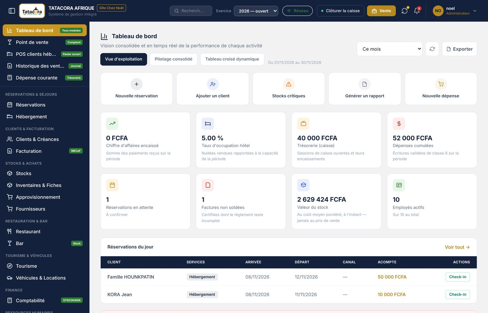
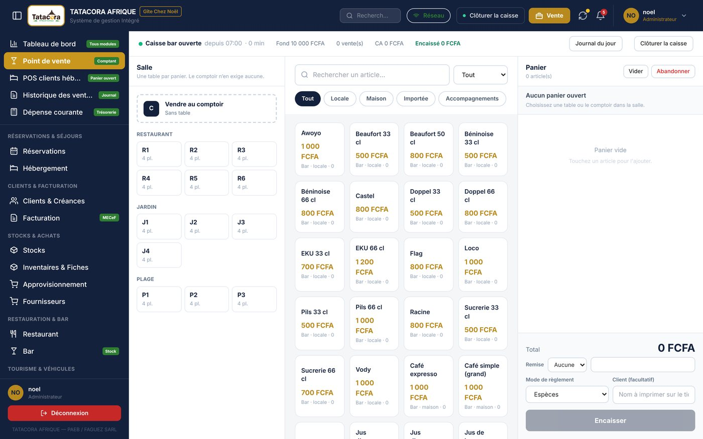
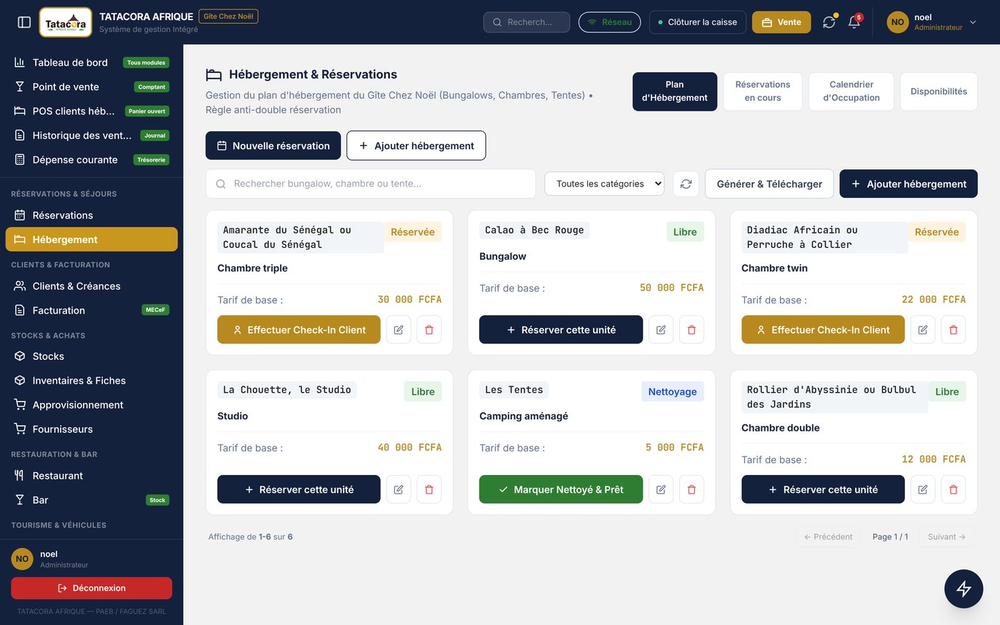
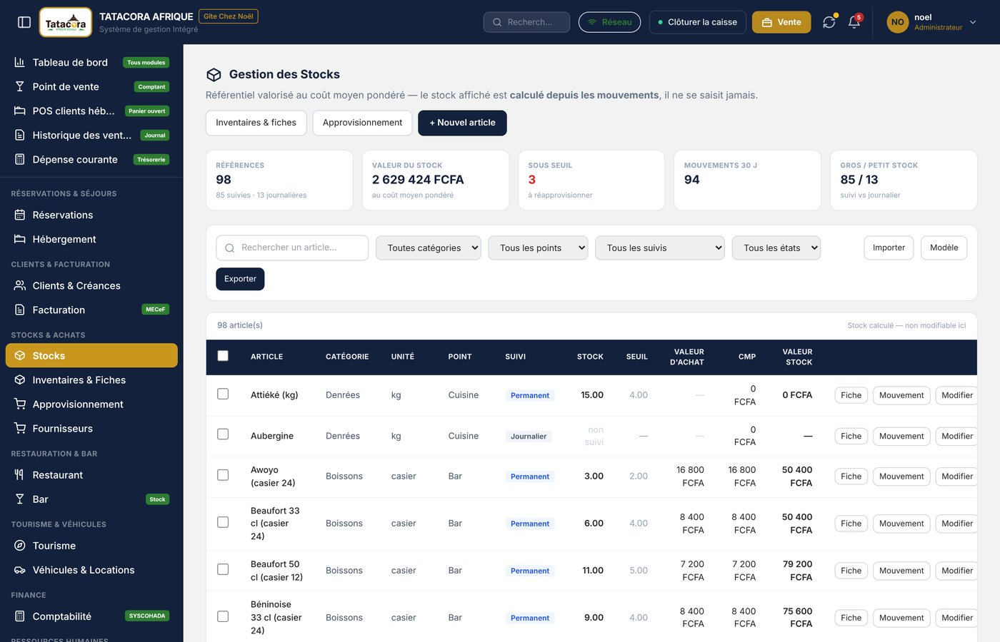
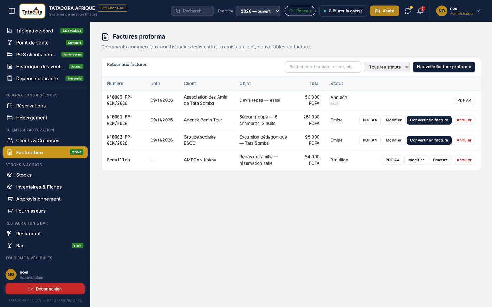

# LogiReStock

**Le logiciel de gestion intégrée pour l'hébergement, la restauration, le tourisme, les stocks et la comptabilité.**

Conçu pour le Gîte Chez Noël (Natitingou, Bénin) — pensé pour les PME qui travaillent avec une connexion qui tombe.

---

## En une phrase

LogiReStock réunit dans **une seule application** tout ce qu'un gîte-restaurant fait au quotidien : réserver une chambre, encaisser au comptoir, tenir le stock, facturer, payer le personnel et tenir une comptabilité aux normes **SYSCOHADA**. Il existe en **version web** et en **poste Windows qui continue de travailler sans connexion Internet**, puis se synchronise tout seul.

## Pourquoi ce logiciel

- **La connexion tombe, la caisse ne s'arrête pas.** Le poste Windows fonctionne entièrement hors ligne : réservations, ventes, factures, stocks, comptabilité. La synchronisation est un plus, jamais une condition.
- **Un seul outil, des chiffres cohérents.** Une vente au bar, une nuitée, un achat fournisseur ou une paie alimentent le même stock et la même comptabilité.
- **Fait pour le terrain.** Interface en français, prix en FCFA toutes taxes comprises, vocabulaire du métier, droits d'accès par rôle.

## Aperçu

<table>
<tr>
<td width="50%"> <b>Connexion</b> — web et poste Windows</td>
<td width="50%"> <b>Tableau de bord</b> — la performance de chaque activité</td>
</tr>
<tr>
<td width="50%"> <b>Point de vente</b> — salle, comptoir, panier, encaissement</td>
<td width="50%"> <b>Hébergement</b> — plan, check-in, disponibilités</td>
</tr>
<tr>
<td width="50%"> <b>Stocks</b> — valorisés au coût moyen pondéré</td>
<td width="50%"> <b>Factures proforma</b> — devis convertibles en facture</td>
</tr>
</table>

## Fonctionnalités principales

### Hébergement et réservations
Plan des bungalows, chambres et tentes, réservation rapide, calendrier d'occupation, check-in et check-out, règle anti-double réservation, annulations avec remboursement plafonné, clôture de séjour et paiement séparé.

### Restauration, bar et point de vente
Caisse unique avec salle et tables, panier, remises, encaissement en espèces, Mobile Money, virement ou crédit, historique des ventes, annulation avec motif. La **carte du Gîte** (plats, boissons, tarifs) est gérée avec son historique de prix.

### Stocks, inventaires et achats
Stock calculé depuis les mouvements (jamais saisi à la main), alertes de seuil, inventaires par magasin, fiches de stock, approvisionnement, réception des commandes avec tolérance, règlement des fournisseurs.

### Facturation
Factures A4 et tickets, avoirs, registre des factures, **factures proforma** (numéro `N°… FP-GCN/…`, montant en lettres, signature et cachet, conversion en facture). **Facturation normalisée** prévue pour les trois modes : désactivée (facture simple), e-MECeF (DGI Bénin) ou boîtier CC300 — *mode livré : désactivé, en cours de validation terrain*.

### Clients et créances
Fiches clients, historique, recouvrement et relances, IFU du client facultatif pour les factures normalisées.

### Tourisme, véhicules et locations
Circuits et départs, réservations de places, parc de véhicules, contrats de location, entretiens, reçu de location imprimable.

### Comptabilité SYSCOHADA
Plan comptable, journaux, grand livre, balance, compte de résultat, bilan, flux de trésorerie, notes annexes, immobilisations, analytique. **Sélecteur d'exercice** (N / N-1), passage automatique à l'année suivante, **clôture annuelle** avec archive légale à empreinte SHA-256. Une pièce validée est immuable : on corrige par contre-passation.

### Ressources humaines et paie
Fiches du personnel, bulletins de paie, congés et plannings.

### Notifications, états et import
Notifications par e-mail, états et rapports, import et export Excel (modèles fournis), sauvegardes, journal d'audit.

### Comptes, sécurité et profil
Rôles et permissions par module, « Mon profil », mot de passe perdu **sans e-mail** (réinitialisation par un administrateur, code de secours), suppression logique des comptes, journal d'audit.

## Le poste Windows

Une application de bureau **hors ligne d'abord** :

- **Elle travaille sans serveur** : toutes les lectures viennent de sa base locale.
- **Elle se synchronise** avec le serveur quand le réseau est là : envoi des saisies dans l'ordre, réception des nouveautés des autres postes, écran des échecs avec causes et corrections.
- **Plusieurs postes** peuvent travailler en même temps (réception, restaurant, bar) et se retrouvent cohérents.
- **Installateur Windows** avec mise à jour sur place (les données sont conservées) et désinstallation sécurisée.
- **Démarrage résilient** : une base abîmée ou une migration qui échoue affichent un écran clair, jamais un blocage muet.

## Documentation

Un **manuel d'utilisation de 160 pages** (PDF illustré) décrit chaque écran, chaque règle et chaque limite connue du logiciel.

## Informations

| | |
|---|---|
| **Éditeur** | Dr MASSENON Rhodes — Docteur en Génie Logiciel et Intelligence Artificielle |
| **Conçu pour** | Gîte Chez Noël, Natitingou (Bénin) |
| **Accompagnement des PME** | FAGUEZ SARL — dans le cadre du PAEB |
| **Technologies** | Application web Laravel et Livewire · poste Windows Flutter · bases MySQL et SQLite |

## Contact

Pour un **usage commercial**, une **démonstration** ou une **collaboration** :

**rarhodes06@gmail.com**

---

© Tous droits réservés. Projet personnel : le code source n'est ni libre de droits ni ouvert à la réutilisation sans accord écrit de l'éditeur.
