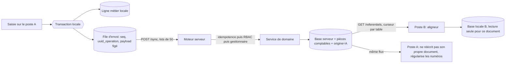
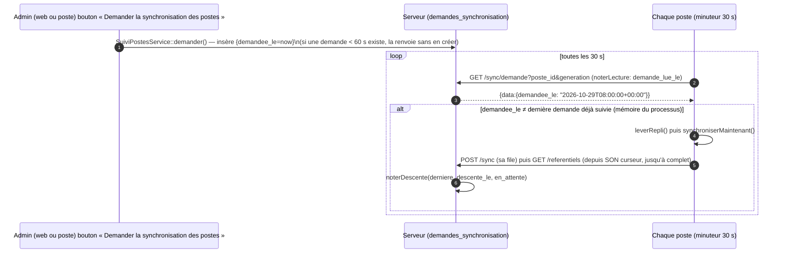

# Blueprint — Synchronisation multi-postes de TATACORA, et comment la refaire ailleurs

> **Nature du document** : guide de référence réutilisable, écrit à partir du code réel de la branche
> `claude/quirky-johnson-2pbs4t` (commit de départ `18005b9`, 29/10/2026). Chaque affirmation clé cite
> `fichier:ligne` ; ce qui **n'existe pas** dans le code est dit comme tel (§1.5). Aucune valeur secrète
> (jeton, mot de passe) n'y figure : les exemples portent des valeurs factices.
>
> **Lecteurs** : le Product Owner (§1 à §2, §11), l'équipe qui maintient TATACORA (§3 à §10), et Claude ou
> toute équipe qui veut reproduire la logique dans un autre projet, éventuellement sur une autre pile
> (§11, §12 : gabarit indépendant de la stack, puis « prompt d'implémentation » à coller tel quel).
>
> **Abréviations de chemins** (pour alléger les citations) :
>
> | Sigle | Chemin complet |
> |---|---|
> | `API/` | `tatacora-api/app/Shared/Sync/` (serveur Laravel 12 : moteur de synchronisation) |
> | `PWA/` | `tatacora-api/app/Pwa/Livewire/Transverse/` (écrans web « Postes & Appairage ») |
> | `SYNC/` | `tatacora-flutter/lib/features/synchronisation/` (poste Windows Flutter : moteur, descente, écrans) |
> | `FL/` | `tatacora-flutter/lib/` |
> | `TESTS-API/`, `TESTS-FL/` | `tatacora-api/tests/Feature/Sync/`, `tatacora-flutter/test/features/synchronisation/` |

---

## Table des matières

1. [Résumé d'une page pour le Product Owner](#1-résumé-dune-page-pour-le-product-owner) — glossaire, ce qui n'existe pas
2. [Architecture d'ensemble](#2-architecture-densemble)
3. [Appairage d'un poste](#3-appairage-dun-poste)
4. [Envoi : poste → serveur](#4-envoi--poste--serveur)
5. [Réception : serveur → postes](#5-réception--serveur--postes)
6. [« Renvoyer vers tous les postes » (bouton web « Synchroniser »)](#6-renvoyer-vers-tous-les-postes-bouton-web--synchroniser-)
7. [Réinitialisation (essais en production, poste neuf, mot de passe perdu)](#7-réinitialisation)
8. [Installation neuve, réinstallation, mise à jour, désinstallation](#8-installation-neuve-réinstallation-mise-à-jour-désinstallation)
9. [Recette à répliquer, gardes de test, pièges rencontrés](#9-recette-à-répliquer-gardes-de-test-pièges-rencontrés)
10. [Annexe A — registres : tables montantes et descendantes](#10-annexe-a--registres)
11. [Gabarit d'implémentation indépendant de la stack](#11-gabarit-dimplémentation-pour-un-autre-projet)
12. [Prompt d'implémentation (à coller dans l'autre projet)](#12-prompt-dimplémentation-à-coller-tel-quel)

---

# 1. Résumé d'une page pour le Product Owner

**Ce que fait TATACORA.** Le Gîte travaille avec **un serveur web** (la source de vérité partagée, `https://logirestock.digitonpro.com`) et **plusieurs postes Windows** (réception, bar, restaurant, économat, direction). Chaque poste est une application **autonome** : elle lit et écrit uniquement sa propre base SQLite (Drift), même sans Internet, pendant des jours. La synchronisation est une **tâche de fond** qui ne bloque jamais un geste (`tatacora-flutter/CLAUDE.md`, « Ce que ce client est »).

**Comment ça circule, en cinq phrases.**
1. Quand on saisit quelque chose sur un poste, la saisie est écrite dans la base locale **et** déposée, dans la même transaction, dans une **file d'envoi** (`operations_sync_local`) avec un identifiant unique créé par le poste (`SYNC/data/operations_sync_dao.dart:73`).
2. Le poste envoie sa file au serveur par lots de 50 (`POST /api/v1/sync`). Le serveur rejoue chaque opération par ses propres règles métier ; un envoi répété ne crée jamais de doublon (idempotence par `uuid_operation`, `API/Services/SynchronisationService.php:203`).
3. Le serveur est le **seul comptable** : le poste n'envoie jamais d'écriture comptable, le serveur passe les siennes (`SynchronisationService.php:59`).
4. Chaque poste **vient chercher** ce que les autres ont écrit (`GET /api/v1/referentiels`, page par page, avec un curseur qu'il garde lui-même) ; il l'applique sans jamais le renvoyer (`SYNC/data/aligneur_catalogue.dart`, docblock).
5. Le serveur **ne pousse rien** : ce sont les postes qui appellent, toutes les 5 minutes, toutes les 30 secondes pour savoir si quelqu'un a cliqué « Synchroniser » sur le web, et après chaque clôture de caisse (`SYNC/presentation/providers_synchronisation.dart:314-361`).

**Ce que ça garantit** : aucune opération perdue (la file survit aux coupures et aux redémarrages), aucun doublon (UUID + idempotence), aucun montant fusionné par la machine (les conflits d'argent vont dans « À traiter » pour un humain), un poste qui marche **sans le serveur**, et un interrupteur « Synchronisation activée » par poste qui coupe tout réseau (`FL/features/transverse/data/configuration_poste.dart:179`).

**Ce qu'un PO doit savoir pour décider, dans un autre projet** : (a) le coût réel est dans les **règles de refus** (chevauchement de chambre, caisse déjà ouverte, table occupée) et dans le **journal des échecs** (« À traiter ») plus que dans le transport ; (b) il faut décider dès le début **qui attribue les numéros** (ici : le serveur, le poste émet un numéro provisoire) ; (c) il faut décider si la **désinstallation efface les données** (ici : oui, avec avertissement Oui/Non, Non par défaut).

## 1.1 Glossaire

| Terme | Sens dans TATACORA |
|---|---|
| **Poste** | Une installation Windows de l'application Flutter. Identifiée par son **nom** (`poste_id`, ex. `COMPTOIR-1`), choisi à l'appairage. |
| **Serveur / web / PWA** | L'application Laravel, hébergée, avec ses écrans web (PWA). |
| **Appairage** | L'acte par lequel un administrateur lie un poste au serveur : le poste se connecte avec un compte serveur, reçoit un **jeton** (Sanctum) **nommé comme le poste**, et le range dans `poste.json`. |
| **Jeton** | Clé d'API remise au poste ; son **nom** est le `poste_id`, que le serveur exige dans chaque requête (`API/Support/PosteDuJeton.php:39`). |
| **Révocation** | Suppression par un administrateur des jetons de ce nom : le poste reçoit 401 au passage suivant. |
| **File d'envoi** | Table locale `operations_sync_local` : une ligne = une opération à pousser (création, modification, suppression limitée). |
| **Opération** | Un fait métier figé en JSON (payload) avec son `uuid_operation`, l'UUID de l'objet (`entite_id`) et l'horodatage de saisie. |
| **Idempotence** | Rejouer la même opération renvoie la même réponse sans rien réécrire. |
| **Gestionnaire** | Classe serveur `Gestionnaire<Table>` : seul chemin d'écriture d'une table synchronisée ; il passe par le service de domaine, comme l'écran web. |
| **Registre** | `RegistreSynchronisation::TABLES_SYNCHRONISABLES` : liste fermée des 44 tables que le serveur accepte de recevoir (`API/Services/RegistreSynchronisation.php:107`). |
| **Catalogue descendant** | Les 48 tables que le serveur met à disposition des postes (`CatalogueDescendantService::COLONNES`, `API/Services/CatalogueDescendantService.php:132`). |
| **Curseur** | Position opaque (par table : date de modif + id) conservée **par le poste** ; elle dit « j'en suis là » dans le flux descendant. |
| **Aligneur** | Côté poste, code qui écrit un élément descendu dans la base locale (jamais d'enfilement, jamais d'écrasement d'une saisie locale en attente). |
| **À traiter** | Liste (poste et serveur) des opérations refusées, en conflit ou bloquées, avec leur cause et les gestes « Corriger / Renvoyer / Relancer ». |
| **Génération des données** | Identifiant du « lot de données » du serveur ; change à chaque réinitialisation ; un poste d'avant est refusé (409). |
| **Bail** | Verrou à durée limitée posé sur un lot en cours d'envoi, pour qu'un autre processus ne le renvoie pas. |
| **Écrivain unique** | Règle : une seule classe écrit une table donnée (ex. `OperationsSyncDao` pour la file). |
| **Miroir** | Table dérivée que le poste d'origine écrit déjà localement (ex. entrées de stock de sa réception) et que le serveur ne lui renvoie donc pas. |

## 1.2 Vue d'ensemble en un schéma

```
 POSTE A (Windows)                      SERVEUR (Laravel / MySQL)                    POSTE B
 ┌──────────────────────┐   POST /sync   ┌─────────────────────────────┐   GET /referentiels  ┌──────────────────┐
 │ Base SQLite (Drift)  │ ─────────────► │ SynchronisationService      │ ◄─────────────────── │ Base SQLite      │
 │  + file d'envoi      │  lots de ≤ 50  │  idempotence → gestionnaire │  pages de 200, curseur│  + aligneurs     │
 │  + curseur descente  │ ◄───────────── │  → service de domaine       │ ───────────────────► │  (n'enfilent     │
 │  + poste.json (jeton)│  résultats/op  │  → pièces comptables serveur│   éléments + miroirs  │   jamais)        │
 └──────────────────────┘                └─────────────────────────────┘                      └──────────────────┘
        ▲  toutes les 5 min, à la clôture de caisse, au clic « Synchroniser maintenant »               ▲
        │  toutes les 30 s : GET /sync/demande  ◄───── « demande » posée par le bouton web ───────────┘
        └──  le serveur NE POUSSE RIEN (pas de WebSocket, pas de notification) ─────────────────────────
```

## 1.3 Chiffres clés du code

| Quoi | Valeur | Source |
|---|---|---|
| Taille d'un lot envoyé | 50 opérations (plafond serveur) | `API/Services/SynchronisationService.php:69`, `API/Http/Requests/SynchroniserRequest.php` |
| Réveil automatique du poste | 5 min | `SYNC/presentation/providers_synchronisation.dart:314` |
| Passage court « demande du serveur » | 30 s | `providers_synchronisation.dart:319` |
| Repli après échec transitoire | 30 s → 2 min → 5 min → 15 min → 1 h (ou `Retry-After`, plafonné à 24 h) | `SYNC/domain/bilan_synchronisation.dart:142-153` |
| Délai d'une requête HTTP | 20 s | `SYNC/data/transport_synchronisation.dart:34` |
| Mémoire d'idempotence | 30 jours | `SynchronisationService.php:84` |
| Taille de page descendante | 200 (500 au plus) | `CatalogueDescendantService.php:106-108` |
| Horizon de stabilité du flux | 5 s | `CatalogueDescendantService.php:110` |
| Silence avant « sans nouvelles » | 24 h | `API/Services/SuiviPostesService.php:187` |
| Anti-rebond du bouton web | 60 s | `SuiviPostesService.php:39` |
| Schéma de la base poste | v46, 78 tables | `FL/core/database/app_database.dart:525`, `tatacora-flutter/CLAUDE.md` |

## 1.4 Décisions du PO qui structurent tout (à reprendre ou à contester ailleurs)

| Décision | Source |
|---|---|
| Le poste fonctionne **sans** le serveur ; l'interrupteur « Synchronisation activée » coupe tout réseau | `docs/AUDIT_POSTE_AUTONOME.md` §1 ; `tatacora-flutter/CLAUDE.md` (« Règles de synchronisation ») |
| « NE PLUS LIMITER » : tous les documents de tous les postes descendent ; aucun plafond de postes | `docs/SPEC_SYNCHRONISATION_COMPLETE.md` §0 |
| Q1 = A : le journal comptable du poste ne contient que **ses** pièces ; les documents des autres postes ne créent pas de pièce locale (puis D246 rouvert le 28/10/2026 pour les comptes du plan et les pièces saisies à la main) | `SPEC_SYNCHRONISATION_COMPLETE.md` §0 ; `tatacora-flutter/CLAUDE.md` (« Comptabilité ») |
| Q2 = A : numéro de facture **provisoire** au poste, numéro continu attribué par le serveur, « régularisé » à l'accusé | `SPEC_SYNCHRONISATION_COMPLETE.md` §0 ; `SYNC/data/sync_manager.dart:626` |
| Q3 : annuler un document saisi sur un **autre** poste = administration et comptable seulement | `API/Support/DocumentsDesAutresPostes.php:29` |
| Désinstaller **supprime** les données, après avertissement Oui/Non (Non par défaut) | `docs/PRD_REINSTALLATION_ET_DEMARRAGE_RESILIENT.md` §5, `tatacora-flutter/installer/tatacora.iss:105-148` |

## 1.5 Ce qui N'EXISTE PAS dans le code (vérifié)

| Idée courante | Réalité dans TATACORA | Preuve |
|---|---|---|
| WebSocket / push / notification serveur → poste | **Absent.** Polling seul : 5 min et 30 s. `BROADCAST_CONNECTION=log`, aucune dépendance Reverb/Pusher/FCM/WebSocket (balayage `lib/`, `app/`, `composer.json`, `pubspec.yaml`). La spec le place hors périmètre. | `docs/SPEC_SYNCHRONISATION_COMPLETE.md` §3 ; `docs/LISTE_DES_CRON_JOBS_CPANEL.md` §3 ; `tatacora-api/.env.example:43` |
| Cron serveur qui « pousse la synchro » | **Absent** : « ce sont les postes qui appellent le serveur ». Le planificateur serveur ne fait que purger (§4.9). | `LISTE_DES_CRON_JOBS_CPANEL.md` §3 |
| Écran web qui crée un jeton / un code d'appairage / un QR | **Absent.** L'appairage se fait **depuis le poste** (identifiant + mot de passe d'un compte serveur + nom du poste). Le web liste, révoque et demande des synchronisations. | `SYNC/data/service_appairage.dart:40`, `PWA/SynchronisationPostes.php` |
| Expiration de jeton | **Aucune configurée** : pas de `config/sanctum.php` dans le dépôt ; le défaut du paquet est `'expiration' => null`. La colonne « Expiration » du web lit `expires_at` s'il existait. | `tatacora-api/vendor/laravel/sanctum/config/sanctum.php:53` ; `SuiviPostesService.php:123-129` |
| Table `postes` dédiée | **Absente** : un « poste » n'existe au serveur que par le **nom des jetons**, `etats_postes_synchronisation` et `sessions_synchronisation`. | `SuiviPostesService.php:130-184` |
| Écran d'arbitrage des conflits financiers | **Absent** : les conflits sont écrits dans `conflits_synchronisation` (`en_attente_arbitrage`) mais aucun écran ni service ne les résout (seul `SynchronisationService` référence le modèle). Le poste dit « arbitrage sur le serveur ». | recherche `ConflitSynchronisation` dans `app/`, `resources/`, `routes/` |
| Suppression synchronisée générale | **Absente** : « supprimer = archiver ». Seule exception : la **purge définitive** d'une unité d'hébergement ou d'un véhicule archivé. | `CatalogueDescendantService.php:52-60` ; `SYNC/domain/operation_sync.dart:44-50,88` |
| Fusion automatique de deux saisies d'argent | **Absente** (hors périmètre de la spec) : tables financières = `arbitrage_manuel`. | `API/Services/ClassificationConflitService.php:34-67` ; `SPEC_SYNCHRONISATION_COMPLETE.md` §3 |
| Sauvegarde automatique du fichier avant migration du poste (R4 du PRD) | **Non livrée** (aucune occurrence de « avant-v » dans `lib/`) ; livrés : écran de panne, journal, réconciliation, tests sur vraies anciennes bases (E1–E3). | `docs/RESTE_A_FAIRE.md` §E ; recherche dans `FL/` |
| Limitation d'essais de connexion sur le poste | **Absente** (le web et l'API limitent à 5 essais / 300 s) | `docs/JOURNAL_DES_LOTS.md` (« Mot de passe perdu… », Limites) ; `AuthController.php:84` |

---

# 2. Architecture d'ensemble

## 2.1 Qui écrit quoi, où

| Donnée | Base serveur (MySQL) | Base poste (SQLite/Drift) | Qui l'écrit | Voyage ? |
|---|---|---|---|---|
| Documents métier de ce poste (vente, dépense, réservation…) | oui, après rejeu | oui (copie d'origine) | le poste d'abord, puis le serveur par son service de domaine | **montée** (`POST /sync`) |
| Documents des **autres** postes | oui | oui, en **lecture seule** (listes, stock, tableau de bord) | le serveur ; le poste les **aligne** | **descente** (`GET /referentiels`) |
| Écritures comptables | oui, **seul** comptable | miroir de lecture `ecritures_serveur_local` + pièces du poste (séparées) | `MoteurComptable` (poste) / services (serveur) | **jamais montée** ; seules les écritures **validées** descendent (`CatalogueDescendantService.php:296-298`) |
| Comptes utilisateurs, mots de passe | oui | oui (comptes **distincts**) | chaque côté | **jamais** (PA-103) |
| Stock, coût moyen, solde client, coût matière | calculés | calculés | chacun | **jamais descendus comme valeur** : on descend les mouvements, on recalcule (`CatalogueDescendantService.php:68-76`) |
| File d'envoi | non (journal de réception à la place) | `operations_sync_local` | **`OperationsSyncDao` seul** | locale |
| Curseur de descente | trace informative (`etats_postes_synchronisation.curseur_descente`) | `etat_synchronisation_local` clé `descente.curseur` | le poste | locale |
| Jeton, nom du poste, interrupteur | tokens Sanctum | `%APPDATA%\TATACORA\poste.json` (**hors** base) | `EcrivainConfigurationPoste` | locale |
| Mémoire d'idempotence | `deduplication_synchronisation` | — | `SynchronisationService::memoriser` (`:971`) | serveur |
| Poste d'origine d'un document | `origines_synchronisation` | `origines_documents_local` | `OrigineDocuments` (serveur), aligneur (poste) | descend (champ `poste_origine`) |

## 2.2 Les principes, chacun avec son ancrage

1. **Le serveur est la source de vérité partagée ; le poste est autonome.** Toutes les lectures du poste viennent de Drift ; « aucun écran n'a de branche *si connecté* » (`tatacora-flutter/CLAUDE.md`, « Ce que ce client est » et « Architecture »).
2. **L'UUID naît côté client**, à la création de l'objet, pas à l'envoi : c'est lui qui rend le rejeu idempotent (`tatacora-flutter/CLAUDE.md` n°2 ; `entite_id` exige un `uuid`, `API/Http/Requests/SynchroniserRequest.php`). `uuid_operation` identifie la **tentative**, `entite_id` l'**objet** — les confondre casserait l'idempotence (commentaire de `SynchroniserRequest`).
3. **Idempotence** : une opération déjà traitée renvoie son résultat d'origine **avant** toute logique (`SynchronisationService.php:203-206,953-964`).
4. **File d'envoi transactionnelle** : `enfiler` **lève** s'il n'est pas appelé dans la transaction de l'écriture métier (`SYNC/data/operations_sync_dao.dart:56-60,73-90`) ; un refus de l'un défait l'autre.
5. **Ordre** : `seq` (AUTOINCREMENT) est l'ordre global d'écriture ; un référentiel écrit avant le document qui le cite part avant lui, sans règle d'ordre à maintenir (`operations_sync_tables.dart` en-tête ; `reclamerLot`, `operations_sync_dao.dart:160`).
6. **Curseurs de descente** : un par table, tenus par le poste, sur le couple (`updated_at`, `id`) ; le serveur reste sans état de curseur (`CatalogueDescendantService.php:25-37`).
7. **Écrivain unique par table** : un test balaie `lib/` et exige que `operations_sync_local` ne soit touchée que par `operations_sync_dao.dart` (`TESTS-FL/ecrivains_file_envoi_test.dart:1279`).
8. **Les aligneurs n'enfilent jamais** (sinon boucle) et gardent toute ligne locale en attente (`SYNC/data/aligneur_catalogue.dart:100-110`, test `descente_catalogue_test.dart:167-183`).
9. **Le serveur n'écrit jamais « en brut »** : chaque table du registre a un gestionnaire qui passe par le service de domaine (mêmes règles que l'écran web). L'ancien repli `DB::table()->insert($payload)` a été supprimé (`SynchronisationService.php:46-58` ; test `RegistreGestionnairesSynchronisationTest.php:138`).
10. **Interrupteur par poste** dans `poste.json` (`synchronisation_activee`, absent = activée), relu avant chaque requête ; tout nouveau chemin réseau **doit** l'appeler (`configuration_poste.dart:179,196-201` ; `tatacora-flutter/CLAUDE.md`).
11. **Le poste fonctionne sans le serveur** : démontré par un test qui joue une journée complète avec un transport qui **lève** au moindre appel (`TESTS-FL/synchronisation_desactivee_test.dart:85`).

## 2.3 Les trois temps de la vie d'une donnée



---

# 3. Appairage d'un poste

## 3.1 Parcours pas à pas

```mermaid
sequenceDiagram
  autonumber
  participant Adm as Administrateur (au poste)
  participant P as Poste (ServiceAppairage)
  participant API as POST /api/v1/login (AuthController)
  participant DB as personal_access_tokens
  participant F as poste.json
  Adm->>P: identifiant + mot de passe d'un compte serveur + nom du poste
  P->>P: nettoyerNomPoste(nom) (lettres, chiffres, - _ . ; 100 car. max)
  P->>API: {identifiant, mot_de_passe, poste}
  API->>API: limite 5 essais / 300 s par (login + IP)
  API->>API: compte actif ? changement de mot de passe exigé ? (403 sinon)
  API->>DB: supprime les jetons de CET utilisateur portant CE nom
  API->>DB: createToken(nom du poste)
  API-->>P: {token, utilisateur{droits par module}}
  P->>F: poste_id, jeton_api, serveur, appaire_le, compte (écriture atomique .tmp + rename)
  Note over P,F: le mot de passe n'est écrit nulle part
```

- **Qui peut appairer** : l'onglet Paramètres → Synchronisation, **Administrateurs seulement** (`SYNC/data/service_appairage.dart:1-12`, `docs/JOURNAL_DES_LOTS.md` « Moteur d'envoi et appairage »).
- **Où est l'adresse du serveur** : celle du **build** (`Environnement.actuel.baseUrl`), jamais une saisie : un build de production ne peut pas pointer ailleurs (`service_appairage.dart:26-29`). Un appairage fait vers une autre adresse que celle du build donne l'état `autreServeur` et rien ne part (`sync_manager.dart:243`).
- **Nom du poste par défaut** : le nom Windows (`COMPUTERNAME`) proposé à l'écran (`FL/features/parametres/presentation/widgets/onglet_synchronisation.dart:77`), mais **modifiable** : c'est le nom saisi qui devient `poste_id`.
- **Côté serveur** : `AuthController::connexion` (`tatacora-api/app/Shared/Auth/Http/Controllers/AuthController.php:75`) — limitation de débit `:84`, refus compte suspendu, refus si mot de passe temporaire non changé (`:127`), **suppression du jeton antérieur de ce poste pour ce compte** (`:141`), puis `createToken($poste)` (`:143`). Le commentaire d'origine : « un appareil perdu ne doit pas conserver un accès parce que son propriétaire s'est reconnecté depuis le même poste ».

## 3.2 Ce que contient `poste.json`

Fichier `%APPDATA%\TATACORA\poste.json` (`configuration_poste.dart:458-472`), **hors** base et hors dossier du programme. Modèle livré sans valeur : `tatacora-flutter/installer/poste.example.json`.

```json
{
  "smtp_mot_de_passe": "(posé à la main ou par l'écran, jamais synchronisé)",
  "poste_id": "COMPTOIR-1",
  "jeton_api": "<jeton Sanctum, jamais affiché ni journalisé>",
  "serveur": "https://logirestock.digitonpro.com/api/v1",
  "appaire_le": "2026-10-15T09:12:00.000Z",
  "compte": "gerant",
  "appairage_refuse": { "code": 401, "le": "2026-10-20T08:00:00.000Z" },
  "synchronisation_activee": false,
  "synchronisation_desactivee_le": "…", "synchronisation_desactivee_par": "…"
}
```

- Les clés d'appairage sont `ClesAppairage` (`configuration_poste.dart:232-246`) ; `appairage_refuse` est posée par le **moteur** sur 401/403 (`:242`, `consignerRefus` `:370`).
- **Écriture atomique** : lecture, changement des seules clés voulues, écriture dans `poste.json.tmp` (`flush`), `rename` (`_modifier`, `:435-455`). Une coupure de courant laisse l'ancien fichier **entier**.
- **Pourquoi pas dans la base** : « la base se copie (sauvegarde), s'exporte, et tout compte qui ouvre Paramètres la lit » (en-tête de `configuration_poste.dart`). Même raison pour l'interrupteur, qui **survit à la réinitialisation de la base** (`docs/AUDIT_POSTE_AUTONOME.md` §1).
- **Expiration** : aucune (§1.5). Le jeton vit jusqu'à révocation, remplacement par un réappairage du même compte et du même nom, déconnexion (`POST /logout`) ou changement de mot de passe du compte (`MotDePassePerduService.php:257` supprime tous les jetons).

## 3.3 Identité du poste : trois « noms » à ne pas confondre

| Nom | Valeur | Rôle | Source |
|---|---|---|---|
| `poste_id` | nom choisi à l'appairage = **nom du jeton** | clé de tout : classification des conflits, `sessions_synchronisation`, `etats_postes_synchronisation`, `origines_synchronisation`, correspondances | `PosteDuJeton.php:39-45` |
| `poste_nom` (v38) | nom de la **machine** (`Platform.localHostname`) à l'instant de l'écriture | journal d'audit du poste (« depuis quel ordinateur »), jamais envoyé | `FL/core/database/auteur_ecriture.dart:35` ; colonnes `auteur_login`/`poste_nom` de `operations_sync_local` (`operations_sync_tables.dart:105-114`) |
| `poste_origine` | `poste_id` du poste qui a créé le document, rendu par le flux | colonne « Poste » des listes, filtre « Ce poste / Tous » | `CatalogueDescendantService.php` (`serialiser`, `origines_synchronisation`) |

**Contrôle d'identité** : le `poste_id` déclaré dans le corps (`POST /sync`) ou la requête (`GET`) doit être celui du jeton, sinon **403** `sync.poste_non_reconnu` pour le **lot entier** (`SyncController.php:48`, `DemandeSynchronisationController.php`, `ReferentielsController.php`). Raison : le `poste_id` commande la classification des conflits (RG-17) et, à la descente, le choix des correspondances rendues. Piège de test : `Sanctum::actingAs()` fabrique un jeton sans nom qui court-circuite le garde ; les tests dédiés utilisent un **vrai** jeton (docblock de `PosteDuJeton.php`).

## 3.4 L'écran web « Postes & Appairage »

Route `pwa.synchronisation-postes` (`tatacora-api/routes/web.php:116`), composant `PWA/SynchronisationPostes.php`. Trois onglets : **Postes**, **Réception**, **Envoi** (les deux derniers réservés aux Administrateurs et au Comptable, `:54-66`). Colonnes : Poste, Utilisateur, Appairé le (premier jeton), Dernier contact (dernier usage du jeton), Expiration, Dernier envoi, Dernier contrôle, **État**, Actions.

L'**état** est calculé par le serveur (`SuiviPostesService::etats()`, `:130-184`) :

| État | Condition |
|---|---|
| `actif` | jeton valide **et** dernier usage il y a moins de 24 h |
| `silencieux` (« sans nouvelles ») | jeton valide mais plus de 24 h de silence |
| `expire` | tous les jetons ont une `expires_at` dépassée |
| `non_appaire` | aucun jeton (révoqué ou jamais appairé) |

L'écran est aussi servi **à l'API** pour le poste (`GET /api/v1/sync/postes`, `routes/api.php:83`) : depuis n'importe quel poste on voit l'état de tous les postes et on peut demander une synchronisation.

## 3.5 Révocation

- **Web** : bouton « Révoquer » (modale de confirmation, jamais `wire:confirm`) → `SuiviPostesService::revoquer` (`:81-109`).
- **Poste** : `POST /api/v1/sync/postes/{poste}/revocation` (`routes/api.php:85`, `SuiviPostesController.php:57`) ; un poste **ne révoque pas le sien** (422 : il se « Dissocie ») ; non-admin → 403.
- **Effet** : suppression de **tous** les jetons de ce nom, **tous comptes confondus** (`jetons()->where('name', $posteId)->delete()`), dans une transaction, avec une ligne `journal_audit` `appairage_revoque` (nombre de jetons, IP). Réservé aux deux rôles d'administration (`estAdministrateur`).
- **Que se passe-t-il sur le poste révoqué** :
  1. au passage suivant, 401 → `SyncManager` consigne `appairage_refuse` `{code: 401}` dans `poste.json` et **arrête tout** : plus aucun envoi ni descente (`sync_manager.dart:407-412`, états `jetonRefuse`/`posteNonReconnu`) ;
  2. le lot en cours est rendu **intact** à la file, la tentative n'est pas comptée (`rendreEnAttente`, `operations_sync_dao.dart:341-355`) : **rien n'est perdu**, la file reste pleine ;
  3. le voyant et l'écran de synchronisation le disent jusqu'au réappairage ;
  4. « Tester la connexion » (401 → « Jeton refusé — réappairer le poste ») ; un **nouvel appairage** efface le refus (`enregistrerAppairage` retire la clé, `configuration_poste.dart:355-361`) ; l'ancienne file part alors dans l'ordre.
- **Dissocier** (côté poste) : `POST /logout` tenté « au mieux » (hors ligne, il n'arrête rien), puis le jeton est retiré du fichier ; **la file n'est pas touchée** (`service_appairage.dart:134-158`). Interrupteur éteint : aucune requête, le jeton reste valide au serveur jusqu'à révocation.
- Tests : `TESTS-API/RevocationAppairageTest.php` (un admin révoque un poste, les autres continuent ; hors administration personne ne révoque ; jamais le sien), `TESTS-FL/appairage_test.dart`.

## 3.6 Plusieurs postes en parallèle

Aucune limite au nombre de postes (décision du 17/10/2026, « 3, 4, 5 postes et plus »). Chaque poste a **son** jeton, **son** curseur, **sa** file. Le serveur traite chaque opération dans **sa propre transaction** (isolation par opération, `SynchronisationService.php:38-41`). Les conflits d'exclusivité (§5.6) sont arbitrés par des **verrous** en base (ex. `lockForUpdate` sur le panier ouvert d'une table, `GestionnairePaniersTable.php:94`).

Limite de **débit de connexion** : par couple (login + IP) et non par IP seule, car « au Gîte tous les postes sortent derrière la même adresse publique » (`AuthController.php:80-83`).

---

# 4. Envoi : poste → serveur

## 4.1 La file `operations_sync_local`

Définition : `FL/core/database/tables/operations_sync_tables.dart:46-125`.

| Colonne | Rôle |
|---|---|
| `seq` (AUTOINCREMENT) | ordre global d'écriture = ordre d'envoi, jamais réutilisé |
| `uuid_operation` (unique) | identifiant de la **tentative** ; rend le rejeu idempotent |
| `table_serveur`, `entite_id` | table du **registre serveur** (jamais le nom local `_local`) et UUID de l'objet |
| `type` | `creation` \| `modification` \| `suppression` (CHECK, `:121`) |
| `payload` | JSON **figé** à l'écriture, déjà au contrat du serveur (jamais relu de la base à l'envoi) |
| `horodatage_client` | instant de **saisie** (UTC) ; arbitre le dernier écrit gagnant |
| `date_metier` | date du document (`AAAA-MM-JJ`) ; le serveur date ses pièces à cette date, pas à la réception |
| `statut` | `en_attente`, `en_cours`, `synchronise`, `rejete`, `conflit`, `bloque` (CHECK) |
| `lot_id`, `verrou_jusqua` | bail du lot en cours d'envoi |
| `tentatives`, `prochaine_tentative`, `derniere_erreur`, `code_http`, `resultat_json`, `id_serveur` | suivi, repli, réponse brute, id serveur si fusion |
| `auteur_login`, `poste_nom` | audit local (non envoyés) |

**Types d'opérations** (`SYNC/domain/operation_sync.dart:185-202`) : `creation` ; `modification` (seulement si le gestionnaire serveur l'accepte : `TableSynchronisee.accepteModification`, `:156-174`) ; `suppression` (registre **fermé** : unités d'hébergement et véhicules, `accepteSuppression`, `:44-50,88`). `enfiler` **refuse** par exception ce que le serveur refuserait par principe (`operations_sync_dao.dart:91-117`) et n'enfile pas une `modification` sans champ changé (`:120`). Le mode démonstration n'enfile rien (`fileSynchronisationActive`, `:119`).

## 4.2 Enfilement (algorithme réel)

```
fonction écrire_métier_puis_enfiler(...):
    transaction locale {
        écrire la ligne métier locale
        OperationsSyncDao.enfiler(table, entite_id, type, payload_figé, horodatage, date_métier)
            # lève StateError si pas dans une transaction            (operations_sync_dao.dart:80-86)
            # lève ArgumentError si le serveur refuserait par principe (:91-117)
            # INSERT operations_sync_local(uuid_operation=uuid v4, statut='en_attente', ...) (:122-147)
    }   # si l'un échoue, l'autre est défait ; tests d'ATOMICITÉ écrivain par écrivain
```

Preuves : `TESTS-FL/ecrivains_file_envoi_test.dart` (groupe « ATOMICITÉ », `:821-1180` : déclencheurs SQLite qui lèvent, posés le temps du geste), « ce qui ne part JAMAIS » (`:1184`).

## 4.3 Réclamer un lot

`reclamerLot(taille=50, bail)` (`operations_sync_dao.dart:160-225`), dans une transaction :

1. liste les opérations non `synchronise`, par `seq` croissant ;
2. **s'arrête** à la première `en_attente` dont `prochaine_tentative` n'est pas échue (« un document ne double jamais ce qu'il cite », `:154-156,204`) ;
3. écarte une opération dont l'**élément** a une opération antérieure non aboutie (en cours, rejetée, en conflit, bloquée) — mais **plusieurs opérations du même élément peuvent partir dans un même lot** (ouverture puis clôture de caisse) ;
4. ignore les opérations « remplacées » (historique d'un « Renvoyer ») ;
5. les passe `en_cours` sous un `lot_id` avec un bail (`verrou_jusqua = maintenant + 5 min` par défaut du moteur, `sync_manager.dart:82`) et incrémente `tentatives`.

Au démarrage, `libererBauxExpires` (`:230`) rend `en_attente` les opérations d'un processus tué. Le bail est **prolongé avant chaque requête** (`prolongerBail`, `:364` ; appelé `sync_manager.dart:372`) : une bissection lente ne se fait jamais reprendre par un autre processus.

## 4.4 La requête et la réponse

`POST /api/v1/sync` (`tatacora-api/routes/api.php:76`, middleware `GenerationDesDonnees`). Corps (contrat : `SynchroniserRequest`, `max:50`, `uuid` obligatoires, `horodatage_client` obligatoire) :

```json
{
  "poste_id": "COMPTOIR-1",
  "generation": "d3b0…(UUID de génération retenue ; absent sur un poste neuf)",
  "operations": [
    {
      "uuid_operation": "6f1c0a5e-0000-4000-8000-000000000001",
      "table": "sessions_caisse",
      "type": "creation",
      "entite_id": "a1b2c3d4-0000-4000-8000-0000000000aa",
      "horodatage_client": "2026-10-29T08:01:12Z",
      "payload": { "point_vente": "bar", "date_ouverture": "2026-10-29", "montant_fond_centimes": 50000, "date_metier": "2026-10-29" }
    }
  ]
}
```

Réponse **200** (le lot a été traité ; le détail est **par opération**, pas un code global — `SyncController.php`, commentaire « 200 et non 207 ») :

```json
{
  "session_id": "uuid",
  "resultats": [
    { "uuid_operation": "6f1c…0001", "statut": "synchronise", "entite_id": "a1b2…" },
    { "uuid_operation": "6f1c…0002", "statut": "synchronise", "entite_id": "…", "fusionne_avec": "uuid-serveur" },
    { "uuid_operation": "6f1c…0003", "statut": "rejete", "entite_id": "…", "motif": "Phrase du serveur", "code_motif": "chevauchement", "entites_en_conflit": ["…"] },
    { "uuid_operation": "6f1c…0004", "statut": "conflit", "entite_id": "…", "type_conflit": "financier_arbitrage_requis", "conflit_id": "uuid" },
    { "uuid_operation": "6f1c…0001", "statut": "synchronise", "entite_id": "…", "rejeu_idempotent": true }
  ]
}
```

- Statuts reconnus par le poste : `synchronise`, `cloture_sans_session_serveur`, `rejete`, `conflit` (`sync_manager.dart:516`, `_statutsConnus`). Une réponse sans résultat lisible pour une opération = échec **transitoire** (réessai).
- Compléments : `resolution` (`version_locale_conservee` / `version_serveur_conservee`), `numero`, `numero_avoir`, `matricule`, `code`… (§4.7).
- Codes HTTP : **401** jeton refusé ; **403** poste non reconnu ; **409** `generation_perimee` (§7.1) ; **413** (le poste divise la taille de lot) ; **422** validation du lot (poste : bissection) ; **429/408/5xx** transitoire.

## 4.5 Que fait le serveur d'une opération (`traiterOperationInterne`, `SynchronisationService.php:199-320`)

```
1. déjà vue ?  → rendre le résultat d'origine + rejeu_idempotent=true            (:203)
2. table hors registre ? → rejete « table_non_synchronisable »                    (:210-216)
3. type = suppression ? → chemin propre (super admin + écriture PARAM)           (:223, traiterSuppression :337)
4. RBAC PAR OPÉRATION : l'utilisateur du jeton doit pouvoir ÉCRIRE (niveau C)
   dans TOUS les modules exigés par le payload                                    (utilisateurAutorise :415)
     → sinon rejete « droit_manquant » ou « compte_inactif » (DÉFINITIF)
5. modification sur table qui la refuse → rejete « modification_non_synchronisable »
6. date_metier illisible → rejete « date_metier_invalide »
7. transaction { appliquer() }                                                   (:492)
     création  : existant ? (fusion|reprendreExistant :583|rejet « entite_existante »)
                 sinon gestionnaire->creer sous l'UUID du poste, origine = poste  (creer :569)
     modif     : inconnu ? gestionnaire->modificationSurInconnu ou rejet « entite_inconnue »
                 sinon conflit ? traiterConflit : gestionnaire->modifier         (:492-560)
8. exceptions métier (RuntimeException) → rejete + phrase + code_motif; chevauchement → code « chevauchement »;
   TOUTE AUTRE exception (bug, panne) SE PROPAGE → HTTP 500 → le poste réessaie  (:300-320)
9. memoriser(résultat) dans deduplication_synchronisation                         (:971)
```

Deux choix à retenir absolument (commentaires `:218-240` et `:300-320`) :
- **Le refus de droit est définitif** (`rejete`, jamais `conflit`) : rejouer n'accorde pas de droits.
- **Un bug serveur ne doit jamais devenir un « rejeté »** : « le client marquerait l'opération comme définitivement refusée et la retirerait de sa file. Une saisie hors connexion parfaitement valide serait perdue… Ce cas s'est produit pendant le développement. » → la requête échoue en 500, le client rejoue, l'idempotence protège les opérations déjà passées.

## 4.6 Reprise après coupure réseau

`SyncManager._envoyer` (`sync_manager.dart:361-465`) applique cette politique, documentée en tête du fichier (`:25-48`) :

| Issue | Effet sur le lot |
|---|---|
| pas de réponse / délai / 408 / 429 / 5xx | opérations `en_attente` avec **repli** 30 s → 2 → 5 → 15 min → 1 h (ou `Retry-After`) ; la synchronisation **s'arrête** (`_transitoire`, `:677`) |
| **401 / 403** | lot rendu **intact** (tentative non comptée), refus consigné dans `poste.json`, plus rien avant réappairage |
| **409** `generation_perimee` | lot rendu intact, réinitialisation consignée, plus rien avant la réinitialisation de CE poste |
| **422** sur le lot entier | **bissection** (`_parMoities`, `:467`) jusqu'à isoler l'opération fautive : seule elle est `rejete` (code 422, phrase du serveur) |
| **413** | taille de lot ÷ 2, lot renvoyé en deux |
| autre 4xx | opérations `rejete` avec ce code, état « alerte », arrêt |
| **200** | chaque résultat est consigné **tel quel** (`marquerResultat`, `operations_sync_dao.dart:255`) |

**Cas critique — réponse perdue** : le serveur a écrit, le poste n'a pas reçu la réponse. Au passage suivant, l'opération (toujours `en_cours`/`en_attente`) repart avec le **même** `uuid_operation` → le serveur répond depuis `deduplication_synchronisation` (`resultatDejaObtenu`, `:953`). Si la mémoire a été purgée (> 30 jours), une `creation` sur un identifiant existant est rendue telle quelle **pour un document** (`reprendreExistant`) ; pour une fiche de référentiel : rejet `entite_existante` (`:569-590`). C'est la raison du TTL de 30 jours (`:70-84`). Test : `TESTS-API/RegistreGestionnairesSynchronisationTest.php:330` (« un rejeu après trois semaines reste idempotent »), essai à 5 postes (§9.1).

Garde-fou : jamais plus de 2000 requêtes par synchronisation (`sync_manager.dart:118`).

## 4.7 Régularisations après l'accusé (numéros attribués par le serveur)

Le poste ne choisit **aucun** numéro définitif de document : à l'accusé `synchronise`, il remplace le provisoire (`SyncManager._consigner`, `:528-625`) :

| Table | Ce que le serveur rend | Ce que le poste fait |
|---|---|---|
| `factures` | `numero` (puis `numero_avoir`, `avoir_id`) | `FactureDao.regulariserNumeros` (`PROV-AAAA-NNNNN` → `F-…`) ; si le numéro est déjà pris par une pièce reçue, la descente retente (`:626`) |
| `ventes` (création) | `numero` `V-…` | `PanierDao.regulariserNumeroVente` |
| `employes` | `matricule` | `EmployeDao.regulariserMatricule` |
| `immobilisations` | `code` `IMMO-AAAA-NNNNN` | `regulariserCode` |
| `contrats_location` | `numero` `LOC-…` | `VehiculeDao.regulariserNumero` |
| `bulletins_paie` | `numero` | `PaieDao.regulariserNumero` |
| toute fusion | `fusionne_avec` (id serveur) | `correspondances_sync_local` (jamais de réécriture d'une clé primaire locale) |

## 4.8 Gestionnaires et registre

- **Contrat** : `API/Contracts/GestionnaireSynchronisation.php:51` — `table()`, `module()`, `modulesRequis(payload)`, `niveauRequis()` (toujours `C`), `serviceDomaine()`, `estFinanciere()`, `accepteModification()`, `accepteSuppression()`, `champDateDocument()`, `tablesMiroirs()`, `creer()`, `reprendreExistant()`, `modificationSurInconnu()`, `modifier()`, `supprimer()`.
- **Registre fermé** : 44 tables, **dans l'ordre où un poste doit les pousser** (`RegistreSynchronisation.php:107-178`) ; `pour($table)` vérifie que la clé et `table()` du gestionnaire coïncident (`:204-228`). Une table absente est refusée explicitement.
- Abstraits : `GestionnaireAbstrait.php:35`, `GestionnaireDocumentAbstrait`, `GestionnaireReferentielAbstrait` (fusion sur **clé naturelle** pour le catalogue).
- Un document peut exiger **plusieurs modules** (une vente avec des plats = M5 **et** M4, comme l'écran en ligne) : contrôle hors transaction pour que la trace `journal_securite` du refus survive (`SynchronisationService.php:406-419`).
- **Côté poste**, l'enum `TableSynchronisee` (`operation_sync.dart:20`) est **relu du PHP** par un test (`TESTS-FL/operations_sync_dao_test.dart:371-390`) : les deux listes ne peuvent pas diverger.

## 4.9 Idempotence : mémoire, purge, TTL

- Table `deduplication_synchronisation` (`uuid_operation` unique, `utilisateur_id`, `poste_id`, `table_concernee`, `entite_id`, `resultat` JSON, `horodatage_client`, `date_traitement`) : migration `2026_08_16_000100_create_deduplication_synchronisation.php:32-70`.
- Elle sert **aussi** à arbitrer les conflits : « horodatage de saisie du dernier poste ayant écrit cette entité » (`horodatageSaisiePrecedente`, `SynchronisationService.php:914-936`).
- Purge quotidienne à 03:00 UTC par `NettoyerDeduplicationSyncJob` (`routes/console.php:87`, `docs/LISTE_DES_CRON_JOBS_CPANEL.md` §2), qui purge aussi le journal de réception (90 jours ; 365 s'il attend une correction : `JournalReceptionService.php:41-44`).

## 4.10 Refus et « À traiter » : causes, corrections, relances

### Côté poste (file d'envoi) — écran `/synchronisation`, onglet Envoi

- **Liste « À traiter »** (`OperationsSyncDao.aTraiter`, `:543`) : opérations `rejete`, `conflit` ou `bloque`, les plus récentes d'abord, sans les rejetées déjà renvoyées.
- **Bloquée** : une opération dont une **antérieure sur le même élément** a été rejetée est `bloque` et **ne part pas** (elle s'appliquerait sur un état que le serveur n'a pas) (`marquerResultat`, `:255-310`). **Débloquer** : seulement quand toutes les antérieures sont abouties ou remplacées par une synchronisée (`debloquer`, `:518`).
- **Cause lisible** : `SYNC/domain/cause_envoi.dart` — registre fermé de `code_motif` relu du PHP par un test (`TESTS-FL/cause_envoi_test.dart:89`). Codes : `donnees_invalides`, `chevauchement`, `entite_inconnue`, `suppression_non_synchronisable`, `entite_existante`, `stock_insuffisant`, `recette_manquante`, `refus_caisse`, `piece_immuable`, `droit_manquant`, `compte_inactif`, `table_non_synchronisable`, `modification_non_synchronisable`, `date_metier_invalide`, `regle_metier`. Chaque code a un **titre** et un **conseil** en français (« Enregistrez d'abord l'approvisionnement manquant, puis renvoyez », « Le compte de ce poste n'a pas le droit d'écrire dans ce module… »).
- **Corriger** = formulaire généré de la charge **figée** (seuls les champs du registre : libellés, noms, montants, dates, quantités — jamais un identifiant, un statut ou une ligne de document), validé avant renvoi (`corrigerCharge`).
- **Renvoyer** (Administrateurs) : `OperationsSyncDao.renvoyer` (`:401`) crée une opération **remplaçante** : même document (ou charge corrigée), **même horodatage de saisie**, **nouvel** `uuid_operation` (sinon le serveur rejouerait le rejet mémorisé). L'ancienne ligne reste, rejetée, marquée remplacée (`operation_remplacee:<uuid>`) : c'est l'historique.

### Côté serveur (journal de réception) — onglet Réception de « Postes & Appairage »

- Table `journal_reception_synchronisation` : une ligne par `uuid_operation` (issue, `code_motif`, motif, **cause en français**, détails, tentatives, charge reçue, charge corrigée, traitement `a_traiter|corrige|relance|ignore`, qui/quand) — migration `2026_10_26_100000_create_journaux_synchronisation.php:50-81`.
- **Corriger / Relancer / Ignorer** : `CorrectionReceptionService` (`API/Services/CorrectionReceptionService.php:289,324,384`) :
  - réservé aux **Administrateurs et au Comptable** (`estAutorise`, `:66`), et il faut l'écriture (`C`) sur **tous** les modules que l'opération aurait exigés de son auteur (`moduleRefuse`, `:118`) ;
  - `corriger` **rejoue pour de bon puis annule** (transaction annulée) : la correction n'est retenue que si le service de domaine l'accepterait ;
  - `relancer` rejoue par `SynchronisationService::traiterOperation` (donc mêmes règles, mêmes pièces, mêmes droits), garde l'**horodatage de saisie** d'origine (la date métier reste celle du poste), sous un **nouvel** `uuid_operation`, verrou sur la ligne : une opération prise en charge ne se relance pas deux fois ;
  - `ignorer` exige un **motif**, tracé au journal d'audit.
- Côté poste, « Réception » (descente) a son propre journal `journal_reception_local` (v37) avec « Corriger » et « Relancer / Relancer tout » (`docs/JOURNAL_DES_LOTS.md` « Réception : journal, causes… »). Un élément refusé pour une donnée fausse **au serveur** ne change pas en le relançant : on corrige à la source, puis on reçoit la version corrigée.

---

# 5. Réception : serveur → postes

## 5.1 Le flux descendant

`GET /api/v1/referentiels?poste_id=…&depuis=<curseur>&limite=200&en_attente=<n>&generation=<g>` (`routes/api.php:97`, `API/Http/Controllers/ReferentielsController.php`).

```json
{
  "data": {
    "elements": [
      { "table": "ventes", "id": "uuid", "actif": true, "modifie_le": "2026-10-29 08:00:00",
        "poste_origine": "COMPTOIR-1", "par": "login-de-l-auteur",
        "donnees": { "numero": "V-2026-00042", "montant_total": "15000.00", "statut": "validee", "…": "…" },
        "lignes": [ { "code": "…", "quantite": 2, "montant": "…" } ] }
    ],
    "correspondances": [ { "table": "fournisseurs", "id_poste": "uuid local", "id_serveur": "uuid serveur" } ]
  },
  "meta": { "curseur": "eyJ2IjoxLCJwIjp7…", "complet": false, "limite": 200 }
}
```

(Forme des éléments : `ReferentielsController.php` docblock, `CatalogueDescendantService::serialiser`, `:753+`.) Refus : 401 (compte inactif), 403 (poste non reconnu), 422 (curseur illisible), 409 (génération périmée).

## 5.2 Le catalogue descendant : `COLONNES`

`CatalogueDescendantService::COLONNES` (`:132-265`) est une **liste blanche** de colonnes par table, **dans l'ordre où un poste doit les écrire** (un élément cité avant celui qui le cite). 48 tables (liste en annexe A). Règles :

- **Des définitions, jamais des valeurs calculées** (leçon PA-129, `:68-76`) : ni stock, ni coût moyen, ni solde, ni coût matière ; une colonne ajoutée demain à une table **n'entre pas par omission**.
- Montants et quantités en **chaînes décimales** (jamais de flottant) ; le poste convertit sans `double` (`entierDepuisDecimal`).
- `ENFANTS` (`:341`) : les lignes d'un document descendent **avec** lui (lignes de vente, de dépense, de facture, de commande, d'inventaire, de réservation).
- `SEULEMENT` (`:296`) : seules les écritures comptables **validées** descendent (immuables, RG-11).
- `NON_NULS` : seuls les paniers **de table** descendent (un comptoir n'occupe rien).
- `LECTURE_LIBRE` (`:266`) : paramètres, rôles, exercices, canaux descendent pour **tout** compte qui synchronise ; le reste est filtré par **RBAC par table** : une table ne descend que si l'utilisateur LIT son module (`lisible`, `:679`) ; le curseur d'une table refusée n'avance pas — le jour où le droit est accordé, elle descend depuis le début ; le journal d'envoi compte ce qui n'est pas livré faute de droit (`JournalEnvoiService::noterPage`, `:41`).
- **Archivé ≠ supprimé** : un élément archivé descend avec `actif: false` ; « rien d'autre n'est jamais retiré du flux » (`:52-66`). La seule suppression est la **purge** (`SuppressionsDescendantes`, pseudo-source `suppressions`, `:120`), rejouée par le poste **seulement si aucune saisie locale n'y est rattachée**.

## 5.3 Curseurs : un par table, tenus par le poste

- Position par table = (`filigrane`, `id`) avec `filigrane = COALESCE(updated_at, created_at, '1970-01-02')` (`:367`) ; l'`id` départage les lignes de la même seconde → ordre total, pagination stable (`lire`, `:638-662`).
- Encodage : JSON `{"v":1,"p":{table:[date,id],…}}` en base64 url-safe (`encoder`, `:1009`) ; `decoder` valide strictement (sources connues, format date, UUID) sinon `InvalidArgumentException` → **422** (`:1021`).
- **Horizon de stabilité** de 5 s : seuls les éléments modifiés avant `maintenant − 5 s` sont servis. Sans cela, une écriture dans la seconde déjà servie (même `updated_at`, `id` plus petit) ou une transaction ouverte avant la lecture et validée après serait **perdue sans bruit** (`:39-50`). Conséquence : un élément créé il y a moins de 5 s attend le passage suivant ; un banc de test doit attendre 6 s (`essai_cinq_postes_test.dart`, attente de 6 s entre les deux passes propres).
- Un élément **modifié** après le passage du curseur a un `updated_at` plus récent : il **repasse** (upsert par `id`) → flux incrémental sans journal des changements, **à condition que tout écrivain d'une donnée descendue fasse avancer `updated_at`** (ex. `CompositionRecetteService::remplacerComposition()` touche la fiche).
- **Où est le curseur** : sur le **poste**, clé `descente.curseur` de `etat_synchronisation_local` (`SYNC/data/descente_catalogue_dao.dart:25,109`), posé **dans la transaction de la page, après ses éléments** (`descente_catalogue.dart:267-297`). Un arrêt brutal rejoue la page entière : chaque alignement est idempotent. Le serveur retient seulement « le dernier curseur rendu » à titre d'information (`JournalEnvoiService::noterPage`, `:77-82`).
- **Reprise d'un poste neuf** : le curseur est posé à chaque page → interruption/reprise sans tout recommencer (exigence P0-7). Le poste fait au plus 500 pages par passage (`maxPages`).

## 5.4 Côté poste : la descente (`DescenteCatalogue._descendre`, `descente_catalogue.dart:139-262`)

```
1. repli PROPRE de la descente non échu ?  → aucune requête (la file est déjà partie) ;
   ne fait que reprendre localement les éléments gardés
2. retenir les fusions déjà rendues à l'envoi (retenirFusionsDeLaFile)       (:156)
3. tant que page incomplète (≤ 500 pages) :
     GET /referentiels?poste_id&depuis=curseur&limite=200&en_attente=n&generation=g
     409  → consigner « serveur réinitialisé », STOP
     401/403 → consigner le refus (poste.json), STOP
     422 (curseur) → oublier le curseur UNE fois, repartir du début            (:212)
     408/429/5xx/injoignable → échec transitoire → repli propre, STOP
     200 → _appliquerPage : UNE transaction { correspondances ; pour chaque élément :
              point de sauvegarde isolé (une ligne fautive n'emporte pas la page) ;
              aligneur.aligner(élément) ; journal de réception ; puis poserCurseur }
4. reprendre en boucle les éléments gardés (dépendance absente, modification locale en attente)
5. consigner le bilan (écran de synchronisation)
```

## 5.5 Les aligneurs : règles qui protègent la donnée locale

`AligneurCatalogue.aligner` (`aligneur_catalogue.dart:100-150`) et `aligneur_documents.dart` (en-tête `:1-35`). Un aligneur **ne fait jamais** :

| Interdit | Mécanisme |
|---|---|
| enfiler (boucle) | balayage du source + comparaison du nombre de lignes de la file avant/après (`descente_catalogue_test.dart:167-183,431`) |
| écraser une modification locale non poussée | `OperationsSyncDao.enSuspens(table, id)` → `ConserveLocalement` (`aligneur_catalogue.dart:104-108`) ; l'élément est gardé (`element_differe:<table>:<id>`) et repris quand plus rien n'attend |
| violer une clé étrangère | dépendance absente → `EnAttenteDeDependance`, gardé, repris en boucle en fin de descente |
| écrire une valeur calculée | aucune colonne locale ne la reçoit |
| réécrire une clé primaire locale | traduction par `correspondances_sync_local` |
| passer une pièce comptable (Q1) | chaque document écrit est inscrit dans `origines_documents_local` ; le rattrapage d'une dépense descendue est refusé |
| écrire un mouvement de stock **dérivé** | les entrées d'une réception descendue descendent elles-mêmes (`mouvements_stock`) ; le serveur ne renvoie pas à un poste celles qu'il a déjà écrites (`tablesMiroirs` → `origines_synchronisation.exclu_pour_poste`, `sansMiroirsDuPoste`, `CatalogueDescendantService.php:668`) |
| supprimer | un archivage serveur archive localement quand la table sait archiver, sinon l'élément reste et le bilan le compte |

**Issues d'un alignement** : `Aligne`, `ConserveLocalement`, `EnAttenteDeDependance`, `RefuseParLePoste` — toutes consignées dans `journal_reception_local` avec leur cause (registre fermé, balayé par `cause_reception_domaine_test.dart` : un motif non classé fait rougir l'essai).

**Une table répliquée a DEUX moitiés** (piège n°11 du `CLAUDE.md` poste) : qui l'écrit **et** qui la descend. Oublier la seconde a produit trois défauts réels (clients, parc, catalogue vendable).

## 5.6 À 2, 3, 5 postes en même temps ; conflits et arbitrage

Mécanique : chaque poste a son curseur ; le serveur est le seul à ordonner. Un document saisi sur A est présent sur B après **deux passages** : celui de A (envoi) puis celui de B (descente). Cible de la spec : **≤ 10 min** si les deux postes sont en ligne (passage de 5 min + marge), ≤ 30 s + horizon si le bouton web est utilisé (`SPEC_SYNCHRONISATION_COMPLETE.md` §2 ; cible déclarée, non garantie par un test chronométré dans le dépôt).

| Situation | Règle | Où |
|---|---|---|
| Même **chambre**, mêmes dates, deux postes hors ligne | le premier arrivé gagne ; le second est **rejeté** `chevauchement` avec `entites_en_conflit`, visible dans « À traiter » (RG-01) | `SynchronisationService.php:284-291` ; `ClassificationConflitService::TABLES_STRUCTURELLES` (`:69`) ; essai réel du 5 postes |
| **Caisse** ouverte deux fois pour le même point de vente | l'ouverture du second est refusée (`refus_caisse`) ; ses ventes sont **acceptées** et signalées (`vente_session_inconnue`) ; sa **clôture** est acceptée en `cloture_sans_session_serveur` + anomalie — « une clôture n'est jamais bloquée » | `GestionnaireSessionsCaisse.php:20-71` |
| **Table de restaurant** ouverte sur deux postes | `GestionnairePaniersTable::creer` : verrou `lockForUpdate` sur le panier ouvert de la table ; occupée par un autre → `RuntimeException` « table occupée » → `rejete` ; la **fermeture** (`modification`) d'une addition inconnue est acceptée sans rien écrire (« une libération n'est jamais bloquée ») | `GestionnairePaniersTable.php:79-129` |
| Même **table de salle** (espace + numéro) créée sur deux postes | fusion sur la clé naturelle (`fusionne_avec`) au lieu d'un doublon | `GestionnaireTablesSalle.php:60-85` |
| Même **fiche de catalogue** (clé naturelle) créée sur deux postes | idem, `fusionne_avec` + correspondance | `GestionnaireReferentielAbstrait` |
| Deux modifications concurrentes d'une fiche **non financière** | **dernier écrit gagnant sur l'horodatage de SAISIE** (jamais l'ordre d'arrivée) ; la ligne `conflits_synchronisation` garde la version perdante (`resolu_local` / `resolu_serveur`) ; résultat `resolution: version_locale_conservee | version_serveur_conservee` | `SynchronisationService.php:711-795` |
| Modification d'une table **financière** (factures, paiements, caisses, mouvements de stock, ventes, dépenses, commandes, bons de réception, écritures, paie…) en concurrence | **jamais de résolution automatique**, quel que soit l'horodatage : `statut: conflit`, `type_conflit: financier_arbitrage_requis` ; les conflits sont écrits en base mais **aucun écran ne les résout** (§1.5) | `ClassificationConflitService::TABLES_FINANCIERES` (`:34`), `SynchronisationService.php:731-745` |
| Le poste d'origine rejoue sa propre modification | pas un conflit : même poste, ou dernière écriture serveur faite par ce poste (cas ouverture + clôture de caisse dans le même lot) | `estEnConflit` (`:834-870`), `derniereEcritureEstDuPoste` (`:880`) |
| Numéros continus | jamais alloués par un poste : provisoire local, définitif serveur (§4.7) | |
| Annuler un document saisi sur un **autre** poste | seulement `administrateur`, `super_admin`, `comptable` | `DocumentsDesAutresPostes.php:29-48` |
| Document de CE poste **annulé au serveur** (vente, encaissement, règlement) | le statut descend et la pièce locale du poste est **contre-passée en entier, une seule fois** (`DescenteCatalogue.moteur`) | `docs/JOURNAL_DES_LOTS.md` « Documents de tous les postes… » ; `TESTS-FL/annulations_serveur_test.dart` |

> **À retenir pour un autre projet** : l'arbitre unique est le serveur ; chaque règle d'exclusivité est testée **deux fois** — au poste (sur tout ce qu'il a reçu) et au serveur (en dernier ressort, sous verrou). Un conflit d'argent n'est **jamais** absorbé en silence.

## 5.7 Contrôle de cohérence (« tout est-il arrivé ? »)

`GET /api/v1/sync/coherence?du=&au=` (fenêtre ≤ 31 jours, `CoherenceService::JOURS_MAX`, `:23`) : par table et par **jour métier**, `nombre` et `total` en centimes pour 7 indicateurs (ventes validées, dépenses, paiements non annulés, factures, réservations non annulées, règlements, mouvements de stock) — `CoherenceService::INDICATEURS` (`:30-38`), filtrés par module lu. Le poste calcule les mêmes comptes localement (`SYNC/data/controle_coherence.dart:80,160`) et affiche « Ce poste a tout reçu jusqu'au… » avec les écarts ; le dernier contrôle est noté pour « Postes & Appairage » (`noterControle`).

---

# 6. « Renvoyer vers tous les postes » (bouton web « Synchroniser »)

## 6.1 Mécanisme exact (lu dans le code)

Le serveur **n'atteint pas les postes** ; il **enregistre une demande** et les postes la **lisent**. Aucun curseur n'est réinitialisé par ce bouton.



- Bouton web : `PWA/SynchronisationPostes.php:78` → `SuiviPostesService::demander` (`API/Services/SuiviPostesService.php:41-50`) ; table `demandes_synchronisation` (`id, utilisateur_id, demandee_le`) ; route poste équivalente `POST /api/v1/sync/demande` (`routes/api.php:82`, réponse 201).
- Lecture par les postes : `DemandeSynchronisationController` (`GET /sync/demande`, `routes/api.php:80`) ; côté poste `SyncManager.suivreDemandeDuServeur` (`sync_manager.dart:152-198`), minuteur `periodeDemandeServeur = 30 s` (`providers_synchronisation.dart:319,350-361`).
- **Condition de déclenchement** : la valeur `demandee_le` lue est différente de celle déjà suivie (`_demandeSuivie`, **en mémoire** : au redémarrage, la première lue est suivie — « une synchronisation de plus, jamais une de moins », `:136-139`). Une demande n'est donc pas un compteur : si deux demandes arrivent entre deux lectures, **une seule** passe.
- **Ce que fait le passage déclenché** : exactement une synchronisation complète (envoi de la file, reçus de dépenses, puis descente **depuis le curseur du poste**) avec le repli de la descente levé (`leverRepli` → `poserRepli(echecs: 0)`). Il ne rejoue pas ce qui est déjà descendu.
- **État affiché** : `demande_suivie` = le poste a **reçu le flux depuis** la demande (`derniere_descente_le >= demandee_le`) — « une simple lecture ne suffit pas : le poste peut s'être arrêté entre les deux » (`SuiviPostesService::etats`, `:168`).
- **Ne marche pas** si : synchronisation désactivée sur le poste, poste non appairé, jeton refusé, serveur réinitialisé constaté, poste éteint (il suivra la demande à son prochain démarrage, la première lue étant suivie).

## 6.2 Ce que le bouton n'est PAS : réinitialiser les curseurs d'un poste

« **Redescendre depuis le début** » est un autre geste, par poste, **Administrateurs seulement**, onglet **Envoi** de « Postes & Appairage » (`PWA/EnvoiSynchronisation.php:63-101`) :

1. `JournalEnvoiService::demanderRedescente` (`API/Services/JournalEnvoiService.php:112-150`) pose `etats_postes_synchronisation.redescente_demandee_le/_par` (une seule demande à la fois) et écrit `journal_audit` `redescente_demandee` ;
2. au prochain `GET /referentiels` de ce poste, `ReferentielsController` appelle `consommerRedescente` (`:109`) : si une demande existe, le **curseur présenté est ignoré** (`$depuis = null`), la demande est consommée (`redescente_faite_le`), et le poste reçoit un curseur neuf. **Aucun changement de contrat côté poste.**
3. Raison de ce détour : « le curseur du flux est conservé PAR LE POSTE : le serveur n'en garde pas… "Redescendre depuis le début" ne peut pas effacer un curseur qui n'est pas ici » (docblock `JournalEnvoiService`, `:20-28`).

Côté poste, le curseur s'oublie aussi tout seul dans deux cas : réponse **422** sur le curseur (`descente_catalogue.dart:212`), et certaines migrations qui font « redescendre une fois » (`DELETE FROM etat_synchronisation_local WHERE cle='descente.curseur'`, ex. `app_database.dart:1193`). Il n'existe **pas** d'écran poste « effacer mon curseur » (recherche `effacerCurseur`).

## 6.3 Cron / planificateur

- **Aucune tâche planifiée serveur ne déclenche la synchronisation des postes** (`LISTE_DES_CRON_JOBS_CPANEL.md` §3). Le cron cPanel unique (`schedule:run` chaque minute) sert à : battement du planificateur, file de jobs, ouverture d'exercices, alertes de stock, MECeF, sauvegarde 02:00 UTC, **purge de la mémoire d'idempotence 03:00 UTC**, journal d'audit, e-mails (`routes/console.php`, table du doc).
- Les déclencheurs de synchronisation sont **tous côté poste**, chacun avec son appelant réel (piège n°1 : « un commentaire qui décrit un déclencheur n'est pas un déclencheur ») : démarrage + toutes les 5 min (`synchronisationAutomatiqueProvider`, `providers_synchronisation.dart:350`, lu par `main.dart`), après chaque **clôture de caisse** (`declencheurSynchronisationProvider`, `:337`, sans l'attendre), bouton de la barre supérieure / « Synchroniser maintenant », réactivation de l'interrupteur, passage court de 30 s. Tests : `TESTS-FL/declencheurs_synchronisation_test.dart:79,114`.
- **Aucune sonde de connectivité** : « la tentative est l'autorité » (`providers_synchronisation.dart:343-349`).

---

# 7. Réinitialisation

## 7.1 Génération des données (le mécanisme)

Table `generations_donnees` (`rang` auto, `generation` UUID unique, `motif`, `utilisateur_id`, `created_at`) : migration `2026_10_19_120000_create_generations_donnees.php:27-34`. `GenerationDonneesService::courante()/ouvrir()/concorde()` (`API/Services/GenerationDonneesService.php:28-46`).

Le middleware `GenerationDesDonnees` (`routes/api.php` l.76, 80, 88, 97) :
- ajoute à **toute** réponse `X-Tatacora-Generation`, `X-Tatacora-Generation-Depuis`, `X-Tatacora-Phase-Essais` (`API/Http/Middleware/GenerationDesDonnees.php:30-35,80-84`) ;
- **refuse en 409** (code `generation_perimee`) une requête qui rappelle une autre génération (`generation` en corps ou en paramètre), **avant tout traitement** : « un poste d'avant la réinitialisation ne renvoie pas ses essais, et ne reçoit pas un catalogue qu'il mêlerait aux siens » (`:60-75`). Le refus est compté (`etats_postes_synchronisation.generation_perimee_nb`).
- Un poste **neuf** (sans génération) **adopte** la courante ; il la **rappelle** ensuite à chaque envoi et chaque `GET` (`descente_catalogue_dao.dart:35,67-76` ; une autre génération ne s'adopte **jamais en silence**).

## 7.2 Procédure « essais en production, puis remise à neuf » (web + postes)

Source complète : `docs/ESSAIS_EN_PRODUCTION_ET_REINITIALISATION.md` (décision du PO du 19/10/2026). Résumé opérationnel :

| Étape | Où | Geste | Vérification |
|---|---|---|---|
| 0 | serveur | `php artisan migrate --force`, `php artisan tatacora:verifier-production` : aucun ÉCHEC | `docs/VERIFICATIONS_APRES_MISE_EN_PRODUCTION.md` §A |
| 1 | serveur | `.env` : `TATACORA_PHASE_ESSAIS=true` (`config/tatacora.php:21`), `config:clear`. **MECeF pas en mode réel** (une facture certifiée DGI ne s'efface pas) | `verifier-production` : « phase_essais : ATTENTION » (normal) |
| 2 | chaque poste | installer la **version courante** puis appairer (un poste d'avant le 19/10/2026 ne connaît pas la génération : le mettre à jour **avant**) | |
| 3 | tous | scénarios d'essai (9 scénarios du doc : réservation A→B, conflit RG-01, caisse, dépense web→postes, bouton « Synchroniser », coupure 10 min, contrôle de cohérence, e-mail, impressions) | |
| 4 | **serveur d'abord** | Administrateur : Paramètres → Activation & Sécurité (ouvrir la bascule) → Import & Export → « Réinitialiser les données de test » → « Réinitialiser comme neuf » → taper `VIDER` | une **sauvegarde complète** est générée **avant**, hors transaction (si `mysqldump` échoue, rien n'est vidé) ; journal d'audit ; **nouvelle génération ouverte** (`ReinitialisationDonneesTestService.php:293-420`, `:330,390`) |
| 5 | **chaque poste** | « Synchroniser maintenant » → voyant **rouge** « Le serveur a été réinitialisé… » (rien n'est parti) ; Administrateur du poste : Import & Export → « Réinitialiser comme neuf » → `VIDER` ; re-synchroniser → **vert** | `FL/features/synchronisation/domain/reinitialisation_serveur.dart:10`, `FL/features/transverse/data/reinitialisation_locale.dart:175,300` |
| 6 | serveur | retirer `TATACORA_PHASE_ESSAIS`, `config:clear`, `verifier-production` : « phase_essais : OK » ; la réinitialisation est désormais **impossible en production** quel que soit le rôle (`enPhaseEssais`, `ReinitialisationDonneesTestService.php:174-183`) | |

**Ce qui est vidé / gardé** (liste fermée côté serveur ET poste ; « toute table ajoutée demain est VIDÉE ») : vidés — clients, réservations, séjours, ventes, factures, encaissements, caisses, dépenses, achats, mouvements, écritures, paie, fournisseurs, guides, tourisme, contrats, **tout le catalogue** (plats, menus, recettes, articles, inventaires, carte, historique des prix), **files de synchronisation**, curseur. Gardés — comptes et rôles, paramètres (dont le mot de passe SMTP chiffré), **appairage des postes**, journal d'audit, parc d'hébergement, canaux, lieux (points de stockage, tables de salle), véhicules, circuits, plan comptable, journaux, exercices (qui repassent à « ouvert »), centres de coût, services RH, modèles de notification. Les numéros repartent à 00001 (calculés sur les documents existants). Les archives de clôture d'essai sont effacées.

Garde-fous : rôle Administrateur/super_admin, mot `VIDER`, bascule `reinitialisation_seeders` (fermée par défaut, relue au moment d'agir), une transaction (tout ou rien), triggers RG-11 retirés puis recréés **dans la même transaction**, ordre de vidage = tri topologique sur `PRAGMA foreign_key_list` (poste) / `information_schema` (serveur). Deux **sondes** énumèrent les jointures au lieu de recopier une liste (`ReinitialisationCatalogueTest` PHP, `reinitialisation_catalogue_test.dart`).

Après la remise à neuf du poste : `etat_synchronisation_local` est vide → plus de génération ni de curseur → le poste **redescend tout** du serveur remis à neuf et adopte la nouvelle génération (`generation_donnees_test.dart:92,127`). `poste.json` (jeton, interrupteur) est **conservé**.

## 7.3 Vérifications après mise en production (extraits)

`docs/VERIFICATIONS_APRES_MISE_EN_PRODUCTION.md` : A. serveur automatique (`down`, `git pull`, `composer install --no-dev`, `migrate --force`, caches, `up`, `tatacora:verifier-production` : environnement, débogage, clé d'application, base, migrations, écriture disque, **planificateur < 3 min**, file d'attente, sauvegarde < 26 h, SMTP, administrateur, phase d'essais, exercice, archives de clôture, MECeF) ; B. à la main (`/up`, connexion, e-mail de test, sauvegarde téléchargée, **« Synchroniser les postes » : chaque poste « Appairé », dernier envoi récent**, journal d'audit, log, `.env` inaccessible) ; C. chaque poste (version = `pubspec.yaml`, base à `%LOCALAPPDATA%\TATACORA\donnees\`, **Tester la connexion**, **Synchroniser maintenant → vert, rien « À traiter »**, **Contrôler maintenant → aucun écart**, impression) ; D. première nuit (sauvegarde de 02:00 UTC). Retour arrière : les migrations sont **additives**, le code seul se restaure.

## 7.4 Réinitialiser UN poste (re-descente complète)

Deux chemins, de portée différente :
1. **Garder la base du poste et seulement redescendre** : « Redescendre depuis le début » depuis le web (§6.2). Les lignes locales en attente sont **conservées** par les aligneurs ; rien n'est supprimé.
2. **Remettre le poste à neuf** : « Réinitialiser comme neuf » (§7.2) — **abandonne la file non envoyée** (le texte de l'écran le dit : « ses opérations non envoyées sont des essais et seront abandonnées », `reinitialisation_serveur.dart:12-18`). Hors phase d'essais en production, ce geste n'est pas disponible. Question ouverte Q6 de la spec (refuser tant que la file n'est pas vide) : non tranchée dans le code.
3. **Réinstaller en supprimant les données** (§8) : base neuve, nouvel appairage, redescente complète de l'historique, la file non envoyée est perdue.

## 7.5 Mot de passe perdu SANS e-mail (pour mémoire)

Décision du PO du 29/10/2026 (`docs/JOURNAL_DES_LOTS.md` « Mot de passe perdu SANS e-mail ») : comptes du web et du poste **distincts**, rien ne se synchronise.
- **Administrateur** : « Comptes utilisateurs → Réinitialiser le mot de passe » → mot de passe **temporaire** de 14 caractères (`random_int` / `Random.secure`), affiché **une fois**, valable **24 h**, changement obligatoire à la prochaine connexion (web : middleware `ExigerChangementMotDePasse` ; poste : garde du routeur ; **l'API refuse tout jeton** tant que le changement n'est pas fait, `AuthController.php:127`). Un admin ne réinitialise ni son propre compte ni un super_admin.
- **Code de secours** de l'administrateur : 25 caractères en 5 groupes, **usage unique**, seul le hash est stocké ; web : `php artisan tatacora:code-secours [login]`, « Mon profil → Code de secours » ; poste : posé à la création du premier compte (fenêtre Copier/Imprimer), écran `/mot-de-passe-administrateur-perdu`. Succès = code consommé + nouveau code remis une fois ; 5 essais puis 15 min (par compte **et** par adresse/poste) ; refus **identique** quelle que soit la cause.
- Après le changement : jetons Sanctum supprimés (`MotDePassePerduService.php:257`), sessions fermées. Audit sans aucun secret (`journal_audit` / `journal_securite_local`), tests qui balaient le journal entier.

---

# 8. Installation neuve, réinstallation, mise à jour, désinstallation

## 8.1 L'installateur Inno Setup (`tatacora-flutter/installer/tatacora.iss`)

| Point | Réalité | Ligne |
|---|---|---|
| **AppId fixe** | `{{DEC5CA97-…}` — « ne le changez jamais » : c'est lui qui fait qu'une version **remplace** l'ancienne | `:59` |
| Dossier programme | `{autopf}\LogiReStock` ; une installation existante garde son dossier | `:67` |
| Fermeture de l'application ouverte | `CloseApplications=yes` | `:85` |
| Données **hors** du programme | base : `%LOCALAPPDATA%\TATACORA\donnees\tatacora.sqlite` ; config : `%APPDATA%\TATACORA\poste.json` ; archives, reçus de dépenses à côté | en-tête `:16-26` ; `FL/core/database/emplacement_base.dart:44` |
| Désinstallation | `[UninstallDelete]` supprime `{localappdata}\TATACORA` et `{userappdata}\TATACORA` **seulement si** l'utilisateur répond Oui | `:105-111` |
| Avertissement | `InitializeUninstall` : liste ce qui sera perdu, dont « **Les saisies NON ENCORE SYNCHRONISÉES… seront PERDUES, définitivement** » ; boutons Oui/Non, **défaut = Non** (`MB_DEFBUTTON2`), Non **annule** la désinstallation | `:120-143` |
| Désinstallation silencieuse | données **gardées** (aucune question possible) | `:124-126` |
| Mise à jour | même `AppId` → programme remplacé, données jamais touchées | `:59` |
| Modèle de config | `poste.example.json` copié dans le dossier programme (aucune valeur réelle) | `:96-98` |

Pourquoi **hors** du dossier programme : la désinstallation et les mises à jour remplacent `Program Files` ; la base y serait détruite, et un compte ordinaire ne peut pas y écrire. Pourquoi pas dans Documents : suppression involontaire, et **OneDrive** corromprait une base SQLite synchronisée (`emplacement_base.dart` en-tête). Une ancienne base de Documents est **déménagée** au premier démarrage (copie avec `-wal`/`-shm`, tailles vérifiées, ancienne **renommée** `.deplacee-vers-appdata`, jamais effacée ; une copie qui échoue lève et le logiciel ne démarre pas sur une base vide).

## 8.2 Démarrage résilient (PRD E1–E3, livrés le 28/10/2026)

| Mécanisme | Où | Effet |
|---|---|---|
| `main()` = `runZonedGuarded` + `FlutterError.onError` + `PlatformDispatcher.onError` | `FL/main.dart:33` | aucune erreur de démarrage silencieuse |
| Fenêtre d'attente « Mise à jour de la base du poste… » **avant** le premier écran métier ; base ouverte **et migrée** (`SELECT 1` forcé) avant l'app | `FL/core/demarrage/demarrage_resilient.dart` | jamais de fenêtre vide |
| Délai maximal **45 s** → « préparation bloquée » + boutons | `demarrage_resilient.dart:27` | |
| **Écran de panne** : message français, cause, chemin du journal, « Copier le détail », « Ouvrir le dossier des données », « Quitter » | `demarrage_resilient.dart` | |
| `demarrage.log` : écriture **synchrone** avec `flush`, **tournant** (5 fichiers, 256 Ko), **secrets expurgés** | `FL/core/demarrage/journal_demarrage.dart:26` | un processus tué garde ce qu'il avait dit |
| `reconcilierSchema` : à la fin de `onUpgrade` et à l'ouverture si `ecartRapide` — table absente → `createTable` ; colonne absente → `ADD COLUMN` (nullable ou `DEFAULT` explicite si `NOT NULL`) ; index et déclencheurs RG-11 recréés ; **jamais destructive** (« en trop » laissé et journalisé) ; rejoue l'élargissement du `CHECK` de la file (v43) | `FL/core/database/reconcilier_schema.dart:116` ; `app_database.dart:1626,1640` | une base à `user_version` correct mais incomplète se répare seule |
| Migrations **additives** et **conditionnelles** (`PRAGMA table_info` avant chaque `addColumn`) | `app_database.dart` (ex. v30) | piège n°3 |
| Tests sur **vraies anciennes bases** : 20 dumps `sqlite_master` extraits des commits réels | `tatacora-flutter/test/fixtures/schemas_anciens/` ; `test/core/database/migration_depuis_anciens_schemas_test.dart:22` ; outil `tool/migration/extraire_schemas_anciens.dart` | migre chaque dump avec le code courant et compare tables/colonnes/CHECK/index/déclencheurs à une base neuve : **écart zéro, aucune ligne perdue** |
| Fixtures de retour arrière centralisées | `test/core/database/retour_arriere_schema.dart` (`_ajoutsParVersion`) | ajouter une version au schéma = ajouter son entrée là, et rien d'autre |

L'essai a trouvé un **écart réel** : la base réelle v44 gardait l'ancien `CHECK (type IN ('creation','modification'))` sur la file ; `from < 43` ne rejouait jamais pour elle, `suppression` aurait été refusé → la réconciliation rejoue l'élargissement (`JOURNAL_DES_LOTS.md` « Démarrage résilient »).

## 8.3 Scénarios

| Scénario | Ce qui se passe | Données non synchronisées |
|---|---|---|
| **Installation neuve** | installateur → premier démarrage : base créée à v46 ; le référentiel comptable s'installe au démarrage ; un administrateur **appaire** le poste (§3) ; la descente télécharge **tout** l'historique page par page, reprenable | n/a |
| **Mise à jour** (même AppId) | programme remplacé ; `onUpgrade` migre la base (palier par palier, ou d'un coup), `reconcilierSchema` complète ; `poste.json` intact (donc **toujours appairé**) | **gardées**, la file repart |
| **Désinstallation, réponse Non** | annulée | gardées |
| **Désinstallation, réponse Oui** | base, `poste.json`, archives, reçus, sauvegardes, logo, `demarrage.log` supprimés | **PERDUES, définitivement** |
| **Désinstallation silencieuse** | données gardées | gardées |
| **Réinstallation avec données gardées** (cas silencieux ou copie) | retrouve base + `poste.json` : appairé, file intacte, migration si version plus récente | gardées |
| **Réinstallation après « Oui »** | poste neuf : base vide, **pas** de jeton → à réappairer ; la descente refait l'historique | perdues avec la désinstallation |
| **Réinstallation sur un PC dont l'ancienne base traîne** | ouverture + migration par le code courant, écran de panne et `demarrage.log` en cas d'échec ; **pas** de sauvegarde automatique avant migration (R4 non livré, §1.5) | exposées à une migration défaillante : sauvegarder le dossier avant |

## 8.4 Appairage après réinstallation : l'ancien jeton, la révocation, les doublons

- **Même compte, même nom de poste** : `POST /login` supprime le jeton précédent de ce compte portant ce nom (`AuthController.php:141`) → l'ancien jeton (resté au serveur après un « Oui » qui a effacé `poste.json`) est **remplacé** ; il n'y a plus d'orphelin.
- **Compte différent ou nom différent** : l'ancien jeton **reste valide** au serveur. L'écran « Postes & Appairage » le montre `actif`, puis `silencieux` après 24 h. **Geste recommandé** : « Révoquer » l'ancien nom (supprime tous les jetons de ce nom, tous comptes confondus).
- **Deux installations simultanées sous le même nom de poste** (ancien PC non éteint + nouveau) : pour le serveur c'est **un seul poste** (`poste_id` identique). Même compte : le **second appairage coupe le premier** (401 sur l'ancien). Comptes différents : les deux fonctionnent ; leurs opérations sont différenciées par `uuid_operation`, donc sans doublon ; mais la classification des conflits, l'origine et les miroirs les confondent. **À éviter** : un nom par machine physique, et révoquer l'ancien avant de remettre en service.
- **Ancienne file d'un ancien poste réinstallée avec les données gardées** : rejouée sans risque (idempotence), tant que la **génération** n'a pas changé ; si le serveur a été réinitialisé depuis, 409 et remise à neuf obligatoire (§7).
- **Après révocation** : le poste garde sa file (§3.5) ; réappairer suffit.

---

# 9. Recette à répliquer, gardes de test, pièges rencontrés

## 9.1 Checklist de recette multi-postes

À dérouler contre le **vrai** serveur (pas des mocks) ; l'essai automatique existe : `TESTS-FL/essai_cinq_postes_test.dart` (5 bases de poste, vrai `php artisan serve` sur `tatacora_test`, vrai transport HTTP, graine fixe, coupures **avant envoi** et **réponse perdue après écriture**, 6 tours dans le désordre puis 2 passes propres avec attente de l'horizon de 6 s, contrôle de cohérence de **chaque** poste ; seuls refus admis : ceux que la règle impose et que « À traiter » montre, p. ex. caisse du bar ouverte pendant qu'un autre poste tenait la sienne).

| # | Cas | Attendu |
|---|---|---|
| 1 | Poste A saisit vente, dépense, réception, réservation de circuit ; passages de A puis de B..E | présents sur les 4 autres avec **poste d'origine** ; aucune opération enfilée par la descente |
| 2 | Coupure réseau **avant** l'envoi, puis rétablie | file intacte, repli 30 s → 1 h, tout part dans l'ordre |
| 3 | Coupure **après** écriture serveur, **avant** réponse (réponse perdue) | rejeu : même `uuid_operation`, `rejeu_idempotent`, zéro doublon au serveur |
| 4 | Poste hors ligne 3 jours puis retour | envoie sa file, reçoit tout ce qu'il a manqué, rien en double |
| 5 | Redémarrage du poste **pendant** un envoi | `libererBauxExpires` rend les opérations `en_cours` ; aucun lot repris par un autre processus pendant le bail |
| 6 | Même chambre/mêmes dates sur A et B hors ligne | un seul gagne ; l'autre en « À traiter » `chevauchement` avec les deux saisies |
| 7 | Deux caisses ouvertes sur le même point de vente | ouverture refusée, ventes acceptées et signalées, clôture acceptée en `cloture_sans_session_serveur` |
| 8 | Même table de restaurant ouverte sur 2 postes | le second refusé (« À traiter »), la libération jamais bloquée |
| 9 | Modification concurrente d'une fiche non financière | dernier saisi gagne (horodatage de **saisie**), version perdante tracée |
| 10 | Modification concurrente d'un document financier | `conflit` `financier_arbitrage_requis`, jamais fusionné |
| 11 | Opération rejetée au milieu d'une chaîne du même élément | les suivantes `bloque` ; Corriger → Renvoyer → Débloquer |
| 12 | Jeton révoqué | 401, état `jetonRefuse`, file **intacte**, réappairage → reprise |
| 13 | Synchronisation **désactivée** (`poste.json`) | **zéro** requête (transport qui lève), file qui se remplit, réactivation → passage immédiat |
| 14 | Serveur réinitialisé | 409, rien ne part ni n'arrive, poste remis à neuf, nouvelle génération adoptée |
| 15 | Bouton web « Synchroniser » | postes `demande_suivie` dans la minute |
| 16 | Poste neuf sur un an d'historique | complet après **reprise sur coupure**, sans doublon (curseur par page) ; cible ≤ 15 min (à chronométrer) |
| 17 | Contrôle de cohérence sur chaque poste | aucun écart de nombre ni de total |
| 18 | Un droit retiré à un compte | la table n'est plus livrée, comptée « non livrée faute de droit » ; le droit rendu → elle descend depuis le début |
| 19 | Mise à jour du poste depuis une vieille version | migration + réconciliation, écart zéro avec une base neuve |
| 20 | Désinstaller : Non annule, Oui efface, silencieux garde, mise à jour garde | cases D5 de `RESTE_A_FAIRE.md` (à faire **par le PO** sur un vrai poste Windows : D1, D3, D5 restent à cocher) |

## 9.2 Gardes de test qui empêchent la dérive

| Garde | Fichier | Ce qu'elle empêche |
|---|---|---|
| **Un seul écrivain de la file** | `TESTS-FL/ecrivains_file_envoi_test.dart:1279` (3 motifs de recherche sur tout `lib/`, plancher et exceptions **nommées**) | un second chemin d'écriture dans `operations_sync_local` |
| **Chaque fichier qui écrit une table synchronisée enfile**, sauf exceptions nommées (réinitialisation, aligneurs) | `ecrivains_file_envoi_test.dart:1304` | un nouvel écrivain qui « oublie » le serveur |
| **Atomicité écrivain par écrivain** | `:821-1180` | une écriture métier sans sa ligne de file (ou l'inverse) |
| **Les aligneurs n'enfilent jamais** | `descente_catalogue_test.dart:167-183,431` | la boucle montée/descente |
| **Liste de tables du poste = registre PHP** | `operations_sync_dao_test.dart:371-390` ; côté PHP `RegistreGestionnairesSynchronisationTest.php:78,138` (chaque gestionnaire déclare module/niveau/service/classification ; le moteur n'écrit plus en brut) | divergence poste/serveur ; table écrite sans règle |
| **Codes de refus du serveur = causes du poste** | `cause_envoi_test.dart:89` | un `code_motif` inconnu affiché brut |
| **Motifs de l'aligneur tous classés** | `cause_reception_domaine_test.dart` (balaie `aligneur_*.dart`) | un refus sans cause lisible |
| **Interrupteur** : transport qui lève | `synchronisation_desactivee_test.dart:85` | un chemin réseau qui ignore l'interrupteur |
| **Déclencheurs réels** | `declencheurs_synchronisation_test.dart:79,114` | « un commentaire qui décrit un déclencheur n'est pas un déclencheur » |
| **Génération** | `generation_donnees_test.dart:59,92,127` ; PHP `ReinitialisationPhaseEssaisTest.php` | mélange d'essais et de production |
| **Révocation** | `RevocationAppairageTest.php:55,94,118` | révoquer sans droit ou son propre poste |
| **Charges contre le vrai serveur** | `tool/sync/valider_charge.php` + `charges_contre_serveur_test.dart` ; `tool/sync/serveur_reel.php` (instantané puis **restauration** de chaque table modifiée) | un contrat de charge qui ne correspond plus au serveur |
| **Migrations sur fichier réel** et anciens dumps | `migration_vNN_*_test.dart` (35), `migration_depuis_anciens_schemas_test.dart` | une migration qui n'a jamais tourné (`onUpgrade` n'est jamais emprunté par un test en mémoire) |
| **Caractères de contrôle invisibles** | `test/core/qualite/caracteres_de_controle_test.dart:49` (plancher de fichiers) | un `\b` de regex écrit par heredoc devenu l'octet 0x08 → garde verte à vide |
| **Cron documenté** | `tatacora-api/tests/Feature/Planification/ListeCronDocumenteeTest.php` | une tâche planifiée absente de `LISTE_DES_CRON_JOBS_CPANEL.md` |

> Règle de méthode commune à toutes : **muter ce qu'on vient d'écrire** (retirer la garde, la ligne, l'appel) et exiger que la suite rougisse ; sinon l'assertion est vide (pièges n°5, 7, 12 du `CLAUDE.md` poste).

## 9.3 Pièges rencontrés (extraits à ne pas redécouvrir)

Sources : `tatacora-flutter/CLAUDE.md` (« Les quatorze pièges »), `docs/JOURNAL_DES_LOTS.md`, `docs/AUDIT_POSTE_AUTONOME.md`, `docs/RESTE_A_FAIRE.md`.

**Données et transport**
1. **La donnée non synchronisée est la seule copie qui existe.** Trois défauts réels : une migration qui recrée une table, un panier perdu à la fermeture, une file qui ne repart jamais (CLAUDE poste, « Ce que ce client est »).
2. **Une file que personne ne vide annonce une attente sans fin** (PA-59/60/61) : la v10 avait retiré `sync_queue` pour cette raison ; elle est revenue avec ses vrais déclencheurs et son écran (JOURNAL, lot F1).
3. **Un bug serveur transformé en « rejeté »** fait perdre une saisie valide (§4.5).
4. **L'horodatage de réception n'arbitre rien** : A saisit à 10 h et synchronise à 14 h, B saisit à 11 h et synchronise à 14 h 05 → B gagne (`traiterConflit`, commentaire `:747-764`). Comparer à la date de réception ferait gagner A.
5. **Ouverture + clôture de caisse dans le même lot** vues comme conflit financier (la clôture est antérieure à l'écriture serveur de l'ouverture) → règle « même poste = pas un conflit » (`estEnConflit`).
6. **TTL de l'idempotence trop court** : 7 jours puis 30 — doit couvrir la plus longue période hors connexion réaliste (`:70-84`).
7. **Horizon du flux** : sans lui, des éléments sont perdus sans bruit (§5.3) ; un banc qui avance l'horloge du moteur doit la donner **aussi** au DAO de la file (échéance d'une reprise jugée sur elle).
8. **Flux descendant : tout écrivain d'une donnée descendue doit faire avancer `updated_at`** (sinon la modification ne repasse jamais).
9. **Une table répliquée a deux moitiés** (écrit / descendu) : clients (PA-127), parc (PA-128), catalogue vendable (PA-129) ; une clé étrangère violée par la première réservation d'un autre poste emportait **tout le lot** → d'où le point de sauvegarde par élément.
10. **`createTable` crée la définition courante** : un poste ancien reçoit des colonnes qu'une migration voudra ajouter (« duplicate column name ») → `addColumn` toujours **conditionnel** (`PRAGMA table_info`) ; fixtures de retour arrière centralisées (piège n°3). Autre piège : `m.createTable` ne crée pas les index `@TableIndex`.
11. **`onUpgrade` n'est jamais emprunté par un test en mémoire** : prouver sur un fichier réel portant des données, en sautant des versions (piège n°2).
12. **`Sanctum::actingAs()` court-circuite le garde du `poste_id`** (PA-54/66) → tests avec jeton réel.
13. **Un jeton ne se compare qu'à l'octet près** : nom de poste nettoyé (`nettoyerNomPoste`) pour qu'un espace final ou une apostrophe typographique ne crée pas un poste que personne ne sait retaper (`appairage.dart:25`).
14. **`php artisan serve` sans `--no-reload`** retire `DB_DATABASE` de l'environnement et relit `.env` = la base de dev (essai de bout en bout) ; les scripts PHP sur `tatacora_test` sont **sérialisés** par un verrou de fichier (D279).
15. **Un indicateur qui affirme un état non vérifié** (« synchronisé » ne se dit que du confirmé) ; l'écran ne dit « à jour » que si la descente est complète (`postesNonAJour`, `SuiviPostesService.php:200`).
16. **Une phrase de l'écran sur de l'argent se vérifie en exécutant le serveur** (piège n°13) ; un lecteur câblé n'est pas un lecteur déclaré (piège n°14).

**Exploitation**
17. **MECeF en mode réel pendant les essais** : une facture certifiée ne s'efface pas avec la base (§7.2 étape 1).
18. **Réinitialiser le serveur avant de mettre les postes à jour** : un poste d'avant la génération ne connaît pas le 409 (§7.2 étape 2).
19. **OneDrive + SQLite** = corruption ; la base ne vit jamais dans Documents (§8.1).
20. **Désinstaller « Oui » efface la seule copie** : bouton par défaut Non, liste de ce qui est perdu, silencieux = garde (§8.1).
21. **Environnement de session de dev** : MySQL s'arrête entre deux tours (`service mysql start`) ; `git fetch origin +refs/heads/<branche>:refs/remotes/origin/<branche>` après chaque push, sinon le hook annonce de faux « commits non poussés » (`CLAUDE.md` poste).

---

# 10. Annexe A — registres

## 10.1 Tables que le serveur ACCEPTE (montée) — 44, dans l'ordre d'envoi

`RegistreSynchronisation::TABLES_SYNCHRONISABLES` (`RegistreSynchronisation.php:107-178`) :

`reservations`, `sejours`, `clients`, `relances_clients`, `fournisseurs`, `points_stockage`, `articles`, `cartes_boisson`, `menus`, `recettes`, `plats`, `indisponibilites_carte`, `categories_hebergement`, `unites_hebergement`, `commandes_achat`, `bons_reception`, `reglements_fournisseur`, `sessions_caisse`, `tables_salle`, `paniers`, `ventes`, `depenses`, `factures`, `paiements`, `circuits`, `guides`, `reservations_tour`, `vehicules`, `contrats_location`, `entretiens_vehicule`, `employes`, `bulletins_paie`, `plannings`, `conges`, `parametres_systeme`, `roles`, `mouvements_stock`, `modeles_notification`, `plan_comptable`, `pieces_saisie`, `immobilisations`, `canaux_reservation`, `inventaires`, `demandes_cloture_exercice`.

Création seule (pas de modification acceptée) : `relances_clients`, `bons_reception`, `depenses`, `entretiens_vehicule`, `plannings`, `parametres_systeme`, `mouvements_stock`, `plan_comptable`, `pieces_saisie`, `immobilisations`, `inventaires`, `demandes_cloture_exercice` (`operation_sync.dart:20-154`). Suppression admise : `unites_hebergement`, `vehicules` (purge).

## 10.2 Tables que le serveur MET À DISPOSITION (descente) — 48

`CatalogueDescendantService::COLONNES` (`:132-265`) : `points_stockage`, `articles`, `cartes_boisson`, `menus`, `recettes`, `plats`, `indisponibilites_carte`, `historique_prix_carte`, `categories_hebergement`, `unites_hebergement`, `tables_salle`, `fournisseurs`, `canaux_reservation`, `clients`, `relances_clients`, `reservations`, `sejours`, `sessions_caisse`, `ventes`, `depenses`, `paniers`, `factures`, `avoirs`, `paiements`, `commandes_achat`, `bons_reception`, `reglements_fournisseur`, `mouvements_stock`, `circuits`, `guides`, `reservations_tour`, `vehicules`, `contrats_location`, `entretiens_vehicule`, `services`, `employes`, `bulletins_paie`, `plannings`, `conges`, `centres_cout`, `parametres_systeme`, `roles`, `modeles_notification`, `exercices_comptables`, `plan_comptable`, `ecritures_comptables`, `immobilisations`, `inventaires` ; plus les pseudo-sources `suppressions` et `correspondances`. Descendent **sans** être montantes : `historique_prix_carte`, `avoirs`, `services`, `centres_cout`, `exercices_comptables`, `ecritures_comptables` (`MODULES_HORS_REGISTRE`, `:275`).

## 10.3 Tables serveur de la synchronisation

| Table | Rôle | Migration |
|---|---|---|
| `deduplication_synchronisation` | mémoire d'idempotence + dernière saisie par entité | `2026_08_16_000100_…` |
| `sessions_synchronisation`, `conflits_synchronisation` | une session par lot ; conflits | `2026_08_01_001200_create_audit_sync.php:30-53` |
| `correspondances_synchronisation` | UUID du poste → UUID serveur (fusions), unique (`table`, `id_poste`) | `2026_10_15_100000_…:41-53` |
| `anomalies_synchronisation` | signalements (écart de caisse, clôture sans session…) | `2026_10_15_200000_…` |
| `origines_synchronisation` | poste d'origine par document (+ `exclu_pour_poste` pour les miroirs), unique (`table`, `entite_id`) | `2026_10_17_100000_…:42-51` |
| `demandes_synchronisation`, `etats_postes_synchronisation` | bouton web ; état par poste (descente, file déclarée, curseur rendu, redescente, génération périmée, dernier contrôle) | `2026_10_18_120000_…`, `2026_10_21_130000_…`, `2026_10_26_100000_…:98-106` |
| `generations_donnees` | génération courante | `2026_10_19_120000_…` |
| `journal_reception_synchronisation`, `journal_envoi_synchronisation` | journaux Réception / Envoi | `2026_10_26_100000_…` |
| `suppressions_synchronisation` | purges descendantes | `2026_10_28_100000_create_suppressions_synchronisation.php` |

---

# 11. Gabarit d'implémentation pour un autre projet

> Indépendant de la stack (Laravel/Flutter ici ; Node, .NET, Java, Electron, Kotlin… ailleurs). Pour chaque brique : **ce qu'elle garantit**, **ce que TATACORA a fait**, **le minimum à reproduire**.

## 11.1 Modèle de données minimal

### Serveur

```
postes(poste_id PK texte unique, nom_affiche, cree_le, revoque_le NULL, derniere_vue_le)
   # TATACORA n'a pas cette table (il déduit le poste du NOM du jeton) : une table dédiée est PLUS SÛRE.
jetons(id, poste_id FK, compte_id FK, hash_secret, cree_le, expire_le NULL, derniere_utilisation_le)
   # nom du jeton == poste_id ; unique actif par (compte, poste_id)
generations(rang auto, generation UUID unique, motif, auteur_id, cree_le)          # §7.1
journal_idempotence(uuid_operation PK/UNIQUE, poste_id, compte_id, table, entite_id,
                    resultat JSON, horodatage_client, traite_le)                   # TTL ≥ plus longue coupure (30 j)
origines(table, entite_id, poste_id, exclu_pour_poste BOOL, PRIMARY KEY(table, entite_id))
correspondances(table, id_poste, id_serveur, poste_id, cree_le, UNIQUE(table, id_poste))
etats_postes(poste_id UNIQUE, derniere_descente_le, en_attente INT, curseur_rendu TEXT,
             redescente_demandee_le NULL, demande_lue_le, dernier_controle_le, generation_perimee_nb)
demandes_synchro(id, auteur_id, demandee_le INDEX)
journal_reception(uuid_operation UNIQUE, poste_id, table, entite_id, issue, code_motif, motif,
                  cause, tentatives, payload, payload_corrige, traitement, traite_par, traite_le)
conflits(session_id, table, entite_id, version_locale JSON, version_serveur JSON, statut)
```

**Colonnes de synchronisation sur chaque table métier synchronisée** : `id` **UUID créé par le client** (jamais un entier auto-incrémenté) ; `updated_at` **à l'horloge du serveur**, indexé, et **mis à jour par tout écrivain** (c'est le moteur du flux incrémental) ; un drapeau d'**archivage** (`actif`) plutôt qu'une suppression ; la clé naturelle (unique) pour fusionner les référentiels créés hors ligne ; `numero` définitif attribué par le serveur uniquement.

### Poste

```
operations_sync(seq INTEGER AUTOINCREMENT PK, uuid_operation UNIQUE, table, entite_id,
                type CHECK IN ('creation','modification','suppression'), payload JSON FIGÉ,
                horodatage_client UTC, date_metier NULL,
                statut CHECK IN ('en_attente','en_cours','synchronise','rejete','conflit','bloque'),
                lot_id NULL, verrou_jusqua NULL, tentatives, prochaine_tentative NULL,
                derniere_erreur, code_http, resultat_json, id_serveur NULL, cree_le, synchronise_le,
                auteur_login, poste_nom)                                           # operations_sync_tables.dart:46
etat_sync(cle PK, valeur, modifie_le)  # curseur 'descente.curseur', génération, repli, éléments gardés, 'operation_remplacee:<uuid>'
correspondances_sync(table, id_serveur, id_local, origine, PK(table, id_serveur))
origines_documents(table, id, poste_origine)      # d'où vient un document descendu
journal_reception_local(table, element_id, issue, cause, element_json NULL, tentatives, …)
config_locale (FICHIER hors base): poste_id, jeton, serveur, appaire_le, compte, appairage_refuse, synchronisation_activee
```

## 11.2 Contrat d'API

| Endpoint | Auth | Entrée | Sortie | Codes |
|---|---|---|---|---|
| `POST /login` | publique, limitée (5 essais / 5 min par login+IP) | `{identifiant, mot_de_passe, poste}` | `{token, utilisateur{droits}}` | 200, 401, 403 (désactivé / changement requis), 422, 429 |
| `POST /logout` | jeton | — | `{message}` | 200 |
| `POST /sync` | jeton | `{poste_id, generation?, operations[1..50]}` | `{session_id, resultats[]}` | 200 (détail par op), 401, 403 poste, 409 génération, 413, 422, 5xx |
| `GET /referentiels` | jeton | `?poste_id&depuis&limite≤500&en_attente&generation` | `{data{elements,correspondances}, meta{curseur,complet,limite}}` | 200, 401, 403, 409, 422 |
| `GET /sync/demande` | jeton | `?poste_id&generation` | `{data{demandee_le}}` | 200, 403, 409 |
| `POST /sync/demande` | jeton | — | `{data{demandee_le}}` | 201 |
| `GET /sync/postes` | jeton | — | `{data{demandee_le, postes[]}}` | 200 |
| `POST /sync/postes/{poste}/revocation` | jeton admin | — | `{data{poste_id, jetons_revoques}}` | 200, 403, 422 (soi-même / non appairé) |
| `GET /sync/coherence` | jeton | `?du&au` (≤ 31 j) | `{data{tables{table{jour{nombre,total}}}}}` | 200, 422 |
| `PUT/GET /sync/<ressource>/{id}/fichier` | jeton | corps binaire / — | fichier | selon besoin (pièces jointes **hors** du flux JSON) |

En-têtes de **toute** réponse de synchronisation : `X-Generation`, `X-Phase-Essais`. Réponse d'erreur de génération : `409 {code:"generation_perimee", generation, reinitialisee_le}`. **Versionner l'API** (`/v1`) : un changement cassant non versionné casse silencieusement une file de plusieurs jours (`routes/api.php` en-tête).

### Exemples de charges

Requête `POST /sync` (ordre = ordre de la file) :

```json
{ "poste_id": "COMPTOIR-1", "generation": "9a7c…",
  "operations": [
    { "uuid_operation": "11111111-1111-4111-8111-111111111111", "table": "sessions_caisse", "type": "creation",
      "entite_id": "aaaaaaaa-aaaa-4aaa-8aaa-aaaaaaaaaaaa", "horodatage_client": "2026-10-29T08:00:00Z",
      "payload": { "point_vente": "bar", "date_ouverture": "2026-10-29", "montant_fond_centimes": 50000 } },
    { "uuid_operation": "22222222-2222-4222-8222-222222222222", "table": "ventes", "type": "creation",
      "entite_id": "bbbbbbbb-bbbb-4bbb-8bbb-bbbbbbbbbbbb", "horodatage_client": "2026-10-29T09:12:30Z",
      "payload": { "session_id": "aaaaaaaa-…", "point_vente": "bar", "date_metier": "2026-10-29",
                   "lignes": [ { "code": "BIERE-33", "quantite": 2, "prix_unitaire": 1500 } ] } },
    { "uuid_operation": "33333333-3333-4333-8333-333333333333", "table": "sessions_caisse", "type": "modification",
      "entite_id": "aaaaaaaa-…", "horodatage_client": "2026-10-29T22:01:00Z",
      "payload": { "date_cloture": "2026-10-29", "montant_constate_centimes": 53000 } } ] }
```

Réponse :

```json
{ "session_id": "…",
  "resultats": [
    { "uuid_operation": "1111…", "statut": "synchronise", "entite_id": "aaaa…" },
    { "uuid_operation": "2222…", "statut": "synchronise", "entite_id": "bbbb…", "numero": "V-2026-00042" },
    { "uuid_operation": "3333…", "statut": "rejete", "entite_id": "aaaa…", "motif": "Caisse déjà clôturée", "code_motif": "refus_caisse" } ] }
```

## 11.3 Algorithmes (pseudo-code)

### Enfiler (poste)

```
fonction enregistrer(geste):
  dans une TRANSACTION locale:
      appliquer le geste sur les tables métier locales
      si synchro_active_globale (pas démo):
          payload = instantané FIGÉ au contrat du serveur (noms, unités, montants entiers/décimaux en chaîne)
          INSERT operations_sync(uuid_operation=uuid(), statut='en_attente', horodatage_client=maintenant_utc(), …)
      # enfiler HORS transaction = erreur de programmation (exception)
```

### Envoyer par lots idempotents (poste)

```
fonction passage():
  si interrupteur_éteint ou non_appairé ou refus_consigné ou génération_périmée: retourner
  libérer_baux_expirés()
  tant que lot = réclamer_lot(50):                   # ordre seq, stop au 1er repli non échu, bail
      prolonger_bail(lot); réponse = POST /sync {poste_id, generation, lot}
      selon réponse:
         injoignable | 408 | 429 | 5xx : marquer_échec_transitoire(lot, repli(tentatives)); STOP
         401 | 403                      : consigner_refus(); rendre_en_attente_sans_compter(lot); STOP
         409 génération                 : consigner_réinit(); rendre_intact(lot); STOP
         413                            : taille = taille/2; rejouer(lot en 2 moitiés)
         422                            : si |lot|=1 alors rejeter(op) sinon bissection(lot)
         200                            : pour chaque résultat: marquer(statut); si rejete → bloquer les suivantes du même élément;
                                          régulariser numéros; (résultat manquant → transitoire)
  ensuite: reçus/fichiers, puis descendre()
```

### Recevoir et aligner (poste)

```
fonction descendre():
  si repli_descente non échu: reprendre_éléments_gardés(); retourner
  curseur = lire('descente.curseur')
  répéter jusqu'à page.complet:
      page = GET /referentiels?depuis=curseur&limite=200
      transaction {
         pour chaque correspondance: retenir(table, id_serveur → id_local)
         pour chaque élément (dans un point de sauvegarde):
             si ligne locale en attente d'envoi → ConserveLocalement (garder pour plus tard)
             sinon si dépendance absente        → EnAttenteDeDependance (garder)
             sinon aligner (upsert par id, clé primaire locale jamais réécrite, JAMAIS d'enfilement)
             journaliser(issue, cause)
         poser_curseur(page.curseur)           # APRÈS les éléments, DANS la transaction
      }
  reprendre_éléments_gardés() en boucle tant qu'un élément passe
```

### Côté serveur : traiter une opération

```
fonction traiter(op, poste, compte):
  si memoire[op.uuid_operation]: retourner memoire[...] + rejeu_idempotent
  si op.table ∉ registre: rejet('table_non_synchronisable')                  # liste FERMÉE
  g = registre[op.table]
  si compte inactif ou sans droit écriture sur TOUS g.modules(payload): rejet DÉFINITIF('droit_manquant')
  si op.type='modification' et non g.accepteModification: rejet
  transaction {
     existant = lire(op.entite_id traduit par correspondances)
     si creation: si existant → (fusion | g.reprendreExistant | rejet 'entite_existante')
                  sinon g.creer(...) PAR LE SERVICE DE DOMAINE  + origine(table,id)=poste
     si modification: si inconnu → g.modificationSurInconnu ou rejet 'entite_inconnue'
                      sinon si conflit(existant, op) → arbitrer ; sinon g.modifier(...)
  }
  capturer UNIQUEMENT les erreurs métier → rejet(phrase, code_motif)
  toute autre exception → laisser remonter (HTTP 500: le poste rejouera)
  mémoriser(resultat); retourner resultat
```

### Résolution de conflit

```
conflit(existant, op, poste) =
     NON si la dernière écriture serveur de cet élément est celle du MÊME poste (suite de son propre document)
     OUI si existant.date_modification > op.horodatage_client
  ou (table non financière ET une saisie plus RÉCENTE a déjà été appliquée)

si table FINANCIÈRE (liste fermée)      : statut='conflit', écrire le conflit, JAMAIS d'auto-résolution
si table STRUCTURELLE (plages/exclusivité): REJET de la 2e opération (chevauchement), pas d'arbitrage
sinon (dernier écrit gagnant)           : comparer op.horodatage_client à la dernière SAISIE appliquée
                                          (jamais à l'heure de réception) ; garder la version perdante en trace
```

### Révocation

```
revoquer(poste, admin):
   exiger admin ; refuser si poste == poste de l'appelant
   transaction { supprimer TOUS les jetons de ce poste (tous comptes) ; journal d'audit }
poste (au passage suivant): 401 → consigner appairage_refuse ; file INTACTE ; arrêt jusqu'au réappairage
```

## 11.4 Diagrammes de flux (récapitulatif)

```mermaid
flowchart TB
  subgraph Appairage
   A1[Admin saisit compte + nom du poste] --> A2[POST /login poste=nom] --> A3[jeton nommé = poste_id] --> A4[(config locale hors base)]
  end
  subgraph Envoi
   E1[Geste métier] --> E2{{transaction}} --> E3[(file seq)] --> E4[POST /sync 50] --> E5[idempotence→RBAC→gestionnaire→domaine] --> E6[(résultat par op)] --> E7[marquer / bloquer / régulariser]
  end
  subgraph Réception
   R1[GET /referentiels depuis curseur] --> R2[page 200 + horizon 5 s] --> R3{{transaction page}} --> R4[aligneurs: pas d'enfilement, garder l'en-attente] --> R5[poser curseur]
  end
  subgraph Renvoi_a_tous
   B1[Bouton web] --> B2[(demande_le)] --> B3[postes: GET /sync/demande toutes les 30 s] --> B4[passage complet depuis LEUR curseur]
  end
```



## 11.5 Ordre de mise en œuvre en étapes testables

| Étape | Livrable | Test d'acceptation |
|---|---|---|
| **0. Socle** | UUID côté client partout ; `updated_at` serveur ; archivage au lieu de suppression ; base locale autonome (aucune lecture réseau) | un écran se charge avec le transport coupé |
| **1. MVP — un poste → serveur** | file transactionnelle ; `POST /sync` idempotent avec **un** gestionnaire ; réponse par opération ; statuts ; repli | rejeu de la même opération 2× = 1 seule ligne ; coupure avant/après réponse |
| **2. Appairage** | `/login` avec nom de poste, jeton nommé, contrôle `poste_id == jeton`, révocation, config atomique hors base | 403 si `poste_id` ≠ jeton ; révocation → 401 + file intacte |
| **3. Descente** | flux paginé (updated_at, id), horizon, curseur poste, aligneurs sans enfilement | un poste neuf se remplit page par page ; arrêt brutal puis reprise sans doublon ; la descente n'enfile rien |
| **4. Multi-postes** | origine par document, miroirs exclus, correspondances de fusion, RBAC par table, conflits (financier/structurel/LWW) | essai 5 postes avec coupures aléatoires (graine fixe) + contrôle de cohérence |
| **5. « À traiter »** | `code_motif` stable, causes en français, Corriger/Renvoyer/Débloquer, journal de réception serveur | chaque code a sa cause (test de balayage) ; un rejet se corrige et passe |
| **6. Supervision** | état des postes (24 h), bouton « Synchroniser » (demande + polling 30 s), « Redescendre depuis le début », contrôle de cohérence | `demande_suivie` dans la minute |
| **7. Production** | génération des données + réinitialisation (sauvegarde avant), `verifier-production`, cron unique, purge de l'idempotence, interrupteur par poste | procédure §7.2 déroulée ; vérifications §7.3 |
| **8. Installateur résilient** | AppId fixe, données hors programme, avertissement Oui/Non (défaut Non), écran de panne, journal, réconciliation, tests sur vraies anciennes bases | §8 et §9.1 cas 19–20 |

## 11.6 Décisions à prendre (et leurs options)

| Décision | Options | Choix TATACORA | Conséquence |
|---|---|---|---|
| Transport temps réel | polling / push (WebSocket, notifications) | polling 5 min + 30 s | simple et robuste sur réseau coupant ; latence ≤ 10 min |
| Numérotation continue | A. provisoire local + définitif serveur ; B. séries par poste | **A** | aucun trou ni collision ; il faut une « régularisation » à l'accusé et un affichage « provisoire » |
| Comptabilité | A. le poste ne tient que ses pièces ; B. le serveur descend ses pièces | A (puis lecture seule des écritures **validées**) | jamais de double comptage ; états du poste = pièces du poste + miroir |
| Conflit sur l'argent | auto / manuel | **manuel**, aucune fusion | il faut un **écran d'arbitrage** (absent ici, §1.5) |
| Conflit hors argent | LWW / fusion de champs | LWW sur horodatage de **saisie** | horloges des postes à surveiller |
| Suppressions | propager / archiver | archiver ; purge limitée à 2 tables | pas de « tombstones » généralisés |
| Curseur | serveur / poste | **poste** (serveur sans état) | « redescendre » = drapeau consommé au prochain appel |
| Identité du poste | table dédiée / nom du jeton | nom du jeton | simple ; une table `postes` évite les orphelins et les homonymes |
| Expiration des jetons | oui / non | non | un poste perdu doit être **révoqué** à la main |
| Désinstaller | garder / effacer | effacer après avertissement (défaut Non) | la perte de la file non envoyée est assumée et dite |
| Valeurs calculées (stock, soldes) | descendre / recalculer | **recalculer** à partir des mouvements | pas de divergence ; descendre **tous** les mouvements |
| Pièces jointes | dans le flux / endpoint dédié | dédié (PUT/GET fichier) | le flux JSON reste petit |
| Réinitialisation de prod | interdite / fenêtre d'essais | fenêtre `PHASE_ESSAIS` + génération | refus 409 des postes périmés |

## 11.7 Pièges à éviter (checklist de revue)

1. Enfiler hors transaction ; relire le payload de la base à l'envoi (au lieu d'un instantané figé).
2. Confondre `uuid_operation` (tentative) et `entite_id` (objet).
3. Capturer **toute** exception serveur en « rejeté » (perte de saisie valide).
4. Comparer à l'heure de **réception** au lieu de l'heure de **saisie** pour arbitrer.
5. Un chemin d'écriture « brut » (insert du payload) qui contourne les règles du domaine.
6. Un curseur sans **horizon** de stabilité ; un écrivain qui ne fait pas avancer `updated_at`.
7. Une table répliquée dont personne n'écrit/descend l'autre moitié (clé étrangère violée → tout le lot perdu).
8. Un aligneur qui enfile (boucle) ou qui écrase une saisie locale non partie.
9. Descendre des valeurs **calculées** ; laisser une colonne entrer dans le flux « par omission » (liste blanche obligatoire).
10. Allouer des numéros continus côté poste.
11. Tests de migration seulement en mémoire ; fixtures « anciennes » fabriquées depuis le schéma courant.
12. Données utilisateur dans le dossier du programme ou dans un dossier synchronisé par OneDrive.
13. Jeton dans la base du poste (elle se copie et s'exporte) ; mot de passe du compte conservé après l'appairage.
14. Un déclencheur décrit dans un commentaire mais appelé par personne ; un indicateur « synchronisé » non vérifié.
15. Une garde de test qui passe **à vide** (motif de regex corrompu, dossier renommé, prédicat dérivé de ce qu'il vérifie) → plancher de fichiers, mutation obligatoire.
16. Réinitialiser le serveur sans génération : les postes renvoient leurs essais.
17. Pas de purge de la mémoire d'idempotence, ou un TTL plus court que la plus longue coupure.

---

# 12. Prompt d'implémentation (à coller tel quel)

> À coller dans une session Claude du **nouveau** projet. Il demande d'abord les décisions, puis construit par étapes testables. Adapter les noms entre `<…>`.

```text
Tu implémentes une synchronisation multi-postes OFFLINE-FIRST dans <PROJET>, calquée sur le blueprint TATACORA
(docs/BLUEPRINT_SYNCHRONISATION_MULTI_POSTES.md). Réponds en français. Ne devine pas : lis le code existant,
cite fichier:ligne, et dis clairement ce qui n'existe pas. AUCUN secret (jeton, mot de passe) dans le code, les
logs, les tests ni la documentation.

ARCHITECTURE (non négociable)
1. Le serveur est la source de vérité partagée ET le seul comptable/numéroteur. Chaque poste est autonome : toutes
   ses lectures viennent de SA base locale ; aucun écran n'a de branche « si connecté ».
2. Les identifiants naissent côté client (UUID). Chaque opération a un uuid_operation (la tentative) distinct de
   entite_id (l'objet). Le serveur est idempotent par uuid_operation (mémoire >= 30 jours).
3. File d'envoi locale (seq autoincrement, payload JSON FIGÉ, horodatage de saisie UTC, statuts en_attente/en_cours/
   synchronise/rejete/conflit/bloque). UN SEUL écrivain (un DAO) ; enfiler() LÈVE hors de la transaction de l'écriture
   métier. Les aligneurs de la descente n'enfilent JAMAIS.
4. Montée : POST /v1/sync {poste_id, generation?, operations[1..50]} -> 200 avec un résultat PAR opération
   (synchronise | rejete+code_motif+motif | conflit). Le serveur écrit via des gestionnaires (un par table, registre
   FERMÉ) qui passent par le service de domaine, jamais en SQL brut. Droits vérifiés par opération. Une exception
   métier -> rejete ; toute autre exception -> HTTP 500 (le poste rejouera). Jamais l'inverse.
5. Reprise : repli 30 s/2 min/5 min/15 min/1 h (+Retry-After), 401/403 -> lot rendu intact + refus consigné, 409
   génération périmée -> arrêt, 422 -> bissection, 413 -> lot/2. Bail sur le lot + prolongation avant chaque requête.
   Un rejet bloque les opérations suivantes du même élément ; Renvoyer = même charge/horodatage, NOUVEL uuid_operation.
6. Descente : GET /v1/referentiels?depuis=<curseur opaque>&limite=200, liste BLANCHE de colonnes par table dans l'ordre
   des dépendances, tri (updated_at, id), horizon de stabilité 5 s, curseur TENU PAR LE POSTE et posé dans la
   transaction de la page APRÈS ses éléments. Jamais de valeur calculée (stock, solde) : on descend les mouvements.
   Archivage, pas de suppression. RBAC par table. Le poste d'origine est renvoyé ; les miroirs d'un poste ne lui sont
   pas renvoyés. Le poste garde toute ligne locale encore en attente (ConserveLocalement) et reprend les dépendances
   manquantes plus tard.
7. Appairage : POST /v1/login {identifiant, mot_de_passe, poste} -> jeton NOMMÉ comme le poste (le jeton précédent du
   même compte et du même nom est supprimé). Le poste_id déclaré doit égaler le nom du jeton (sinon 403). Config du poste
   (poste_id, jeton, serveur, interrupteur) dans un FICHIER hors base, écriture atomique (tmp + rename). Le mot de passe
   n'est jamais conservé. Révocation admin : supprime tous les jetons de ce nom ; le poste reçoit 401, garde sa file.
8. Interrupteur « synchronisation activée » par poste, relu avant CHAQUE requête réseau ; éteint = zéro requête.
9. Conflits : tables financières = jamais de résolution automatique (statut conflit) ; tables d'exclusivité (plages)
   = rejet de la 2e opération ; le reste = dernier écrit gagnant sur l'horodatage de SAISIE (jamais la réception),
   version perdante tracée. Numéros continus attribués par le serveur ; le poste émet un provisoire et le régularise à l'accusé.
10. « Synchroniser » web : le serveur n'atteint pas les postes ; il enregistre une demande (anti-rebond 60 s) que chaque
    poste lit toutes les 30 s (GET /v1/sync/demande) pour lancer un passage complet depuis SON curseur.
    « Redescendre depuis le début » = drapeau par poste consommé au prochain GET /referentiels (curseur présenté ignoré).
11. Génération des données : changer à chaque réinitialisation ; les routes de synchro renvoient X-Generation et refusent
    409 generation_perimee une génération périmée. Réinitialisation = sauvegarde AVANT, transaction unique, liste fermée.
12. Supervision : état des postes (actif / sans nouvelles > 24 h / non appairé), journal de réception serveur avec
    cause en français et Corriger/Relancer/Ignorer (droits du module), « À traiter » sur le poste, contrôle de
    cohérence par table et par jour (<= 31 j).
13. Installateur : identifiant d'application FIXE, données hors du dossier programme et hors dossier synchronisé par
    un cloud, désinstallation avec avertissement Oui/Non (défaut Non, silencieux = garde les données), mise à jour =
    jamais d'effacement. Démarrage résilient : écran de panne, journal tournant sans secret, migrations additives
    CONDITIONNELLES + réconciliation de schéma non destructive, tests de migration sur de VRAIES anciennes bases.

MÉTHODE
- D'abord, pose-moi ces décisions et propose un défaut : transport (polling/push), numérotation (provisoire/série par
  poste), comptabilité (pièces du poste seules / pièces du serveur descendues), conflits financiers (écran d'arbitrage
  à prévoir), désinstallation (effacer ou garder), expiration des jetons, table postes dédiée.
- Procède par ÉTAPES TESTABLES, une à la fois, suite verte avant la suivante : (0) UUID + updated_at + archivage ;
  (1) file + POST /sync idempotent avec UN gestionnaire ; (2) appairage/révocation ; (3) descente paginée + curseur ;
  (4) multi-postes (origines, miroirs, conflits, RBAC par table) ; (5) À traiter + causes ; (6) bouton Synchroniser,
  redescente, cohérence ; (7) génération + réinitialisation + vérification de production ; (8) installateur résilient.
- Gardes de test OBLIGATOIRES (et prouve-les par mutation : retire la ligne gardée, la suite doit rougir) : un seul
  écrivain de la file ; enfiler hors transaction lève ; atomicité écriture métier/file ; les aligneurs n'enfilent
  jamais ; la liste de tables du poste = le registre serveur (lu par le test) ; chaque code_motif a sa cause ;
  interrupteur éteint = transport qui lève jamais appelé ; essai à 5 postes contre le vrai serveur avec coupures
  aléatoires (avant envoi ET réponse perdue) puis contrôle de cohérence sans écart ; migration depuis de vraies
  anciennes bases (écart zéro avec une base neuve).
- Pièges à éviter : enfilement hors transaction ; capturer toute exception en « rejeté » ; arbitrer sur l'heure de
  réception ; écriture serveur « brute » ; curseur sans horizon ; table répliquée dont la moitié « descente » manque ;
  descendre des valeurs calculées ; numéros continus côté poste ; jeton dans la base du poste ; garde de test verte à vide.
- À la fin de chaque étape : liste ce qui est livré, ce qui n'existe PAS encore, les tests ajoutés, et les risques.
```

(≈ 65 lignes de prompt entre les barrières.)

---

*Fin du blueprint. Mis à jour : 29/10/2026. Pour l'historique détaillé de chaque lot et ses pièges : `docs/JOURNAL_DES_LOTS.md` ; pour ce qui reste à faire : `docs/RESTE_A_FAIRE.md` (cases D1, D3, D5, D6 à cocher par le PO sur un vrai poste).*
